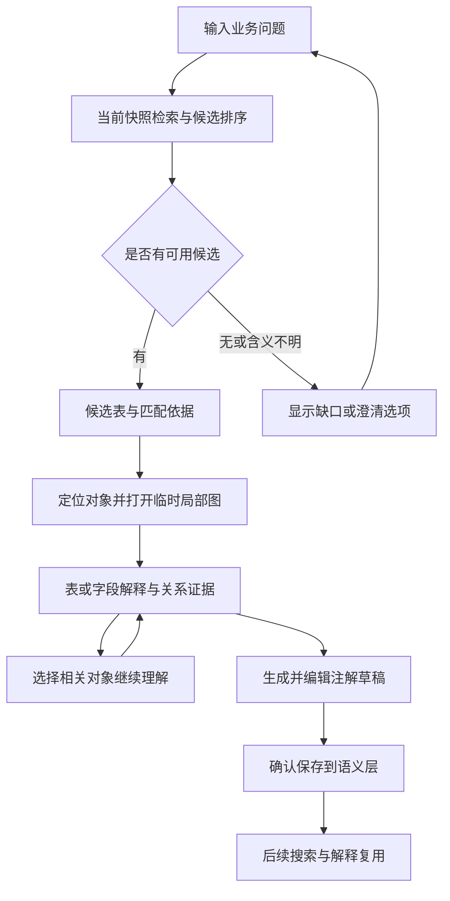

# AI 陌生数据库理解：首期功能与实施方案

> 日期：2026-10-18；验收状态更新：2026-10-19
>
> 状态：首期 F1–F4、阶段一至三及已发现的 review 修复均已实现并完成本地回归。功能状态与剩余验收清单以 §9 为准；执行证据见 [验收记录](AI_DATABASE_UNDERSTANDING_ACCEPTANCE.md)。真实模型效果、真实数据库集成与真实双设备验收分别记录。
>
> 修订：2026-10-18，按多角色 review 补齐 P1 发送范围契约与 P2 跨机器注解复核规则；随后按用户逐阶段授权实施。阶段三已补齐本机确认、失效规则与 Git/云隔离 A/B 接收测试。
> 验收更新：两个真实项目库与本机 Cloud 服务已通过验证；按用户批准清单完成 20 题真实模型调用和应用校验。业务负责人核对、用户效果对照和真实双设备仍待完成。
>
> 已确认方向：优先帮助开发者理解陌生数据库，找表、理清关联和业务含义。
>
> 当前交付：单表解释与证据定位、业务语言找表与局部关系导航、逐条知识草稿及显式确认复用。未扩展现有共享字段；2026-10-19 按用户授权整理提交，范围与验证见 [本次交付记录](AI_DATABASE_UNDERSTANDING_DELIVERY.md)。

## 1. 产品目标与核心问题

目标用户是接手已有项目、跨模块开发或排查问题的开发者。用户带着一个业务问题进入 Nodal Studio，需要找到相关对象，理解结构，并知道哪些结论仍需向团队核实。

首期围绕三个连续问题设计：

1. **在哪里？** 知道业务概念，但不知道数据库表名、缩写和命名习惯。
2. **怎么关联？** 找到一张表后，不知道相关表在哪里、通过哪些字段连接。
3. **为什么这样设计？** 看得懂字段名称，但不理解记录粒度、表的职责和业务含义。

典型困难包括：几百张表缺少阅读入口；中文业务术语与英文表名不对应；物理外键缺失；同名字段在不同模块中含义不同；理解只停留在个人记忆中。

AI 的价值是提供有依据的对象推荐、阅读顺序、解释和待确认问题。表数、字段数、外键是否存在等确定性信息继续由程序计算。

**首期完成标准：用户可以从一个业务问题出发，找到相关表，打开局部关系图，核对解释，并把确认过的理解保存为可复用的注解。**

## 2. 实施前基础与原设计缺口（历史基线）

以下保留 2026-10-18 实施前的静态核对，用于说明设计动机。表中缺口现已在阶段一至三补齐，不是当前待开发清单；当前状态见 §9，实施记录见 §11–13。

| 原有基础 | 实施前实现 | 首期补齐内容（现已实现） |
|---|---|---|
| 数据库模型 | PostgreSQL/MySQL 结构快照、ER 图、关系导航、搜索、语义注解和业务域 | 将这些信息组织成面向问题的解释上下文 |
| AI 入口 | 右侧 AI 面板可提交问题、显示解释、确认候选注解 | 任务入口、可点击对象与证据、草稿编辑和明确的请求状态 |
| AI 上下文 | 表、业务域和变更上下文构建；表上下文包含字段名/类型、主键、出向关联目标、表注释和描述 | 字段注释、空值性、唯一性、完整字段映射、相关约束、已确认逻辑关系与来源信息 |
| 模型调用 | 确定性的离线结构摘要；兼容接口的远程模型调用；设置与策略控制 | 明确区分离线摘要与模型推理，增加结构化结果校验、实际请求范围与预算控制 |
| 解释结果 | 文字解释与证据列表；远程结果沿用离线结构统计作为 evidence，整段生成文字作为候选注解 | 将具体判断关联到具体依据，独立生成简短注解草稿 |
| 运行边界 | Desktop 提供 AI 调用；Web 当前没有 AI 执行路由；DDL 导入是独立临时预览 | 首期沿用边界，不将普通快照的 AI 能力自动扩展到其他来源 |

核对入口：

- [产品定位与原始计划](../DEVELOPMENT_PLAN.md)
- [AI 面板](../apps/frontend/src/components/AiAssistant.tsx) 与 [Inspector 集成](../apps/frontend/src/components/InspectorPanel.tsx)
- [AI 上下文与离线摘要](../crates/ai-context/src/lib.rs)
- [Desktop AI 调用与配置校验](../apps/desktop/src-tauri/src/lib.rs)
- [普通对象搜索](../apps/frontend/src/graph/schema-search.ts) 与 [关系图及已有推断规则](../apps/frontend/src/graph/schema-graph.ts)
- [当前平台能力](CAPABILITIES.md)、[结构预检范围](SCHEMA_PREFLIGHT.md)、[DDL 临时来源范围](DDL_IMPORT_PREVIEW.md)

## 3. 首期范围

### 3.1 功能清单

| 编号 | 功能 | 用户输入或触发 | 必须交付的结果 |
|---|---|---|---|
| F1 | 用业务语言找表 | 输入“支付失败记录”“用户权限”等业务问题 | 当前来源中的候选表、相关字段、匹配理由和定位操作；允许无结果与多种解释 |
| F2 | 解释表与字段 | 选中表或其字段，选择预置问题或输入问题 | 记录粒度、结构事实、业务推测、未知信息；判断关联到可查看的证据 |
| F3 | 解释关联路径 | 从候选表展开关联，或选择当前表的关系 | 局部关系图、逐边字段映射与依据；明确关系种类、范围和未找到路径的情况 |
| F4 | 保存确认过的理解 | 从回答提取注解草稿，编辑后确认 | 独立于物理结构的对象描述；保留现有语义字段，后续搜索与解释可复用 |

四项共同组成首期交付。实施顺序为 **F2 → F1/F3 → F4**，每阶段先验证再继续扩展。

### 3.2 适用对象与运行范围

- 以 Desktop 当前数据源的最新已加载数据库快照为首期入口，支持 PostgreSQL/MySQL 已采集到的元数据；不要求每次问题都重新连接数据库。
- 查找以表为入口，字段和关系作为理解与导航对象。独立视图、函数、触发器的全面解释不属于首期承诺。
- 使用物理外键及当前有效、已确认的逻辑关系组织主要导航路径。没有物理外键时，仍可按名称、注释和语义找到候选对象。
- 可展示并解释已有规则产生的关系候选，但候选不并入已确认路径，不自动保存。AI 自主批量发现、创建新逻辑关系另行设计。
- 业务语言的本地检索默认覆盖当前来源的整个已加载快照，不隐式继承画布的局部过滤。若用户主动限定当前选区或业务域，界面必须显示该范围。本地检索、画布浏览和模型发送范围相互独立，按 §6.1 的行为表约束外发。
- 历史快照、比较中的删除对象、临时 DDL 来源与 Web Viewer 不接入本轮新增交互；显示能力限制，不将它们冒充当前可编辑对象。

### 3.3 后续方向

自动划分业务域、全库文档批量生成、变更影响解读、代码/API 血缘、自然语言 SQL 和业务数据分析保留为后续方向。首期只需在语义注解上形成最小知识复用过程。

现有 Query 可以由用户主动执行受约束的只读查询；本方案的 AI 功能不自动执行查询，不将查询结果或历史加入模型上下文。AI 不执行 DDL，也不修改物理快照、数据库注释或约束。

## 4. 首期功能设计

### 4.1 F1：用业务语言找表

**问题示例：**“订单支付相关的结构，从哪张表开始看？”

检索先利用本地对象名称、字段名称、允许使用的注释、当前有效的已确认语义和业务域。模型可以帮助解释业务词、补充同义词并排序允许外发的候选，但所有候选必须解析为当前快照内真实存在的对象。待复核说明不参与业务含义召回、模型排序或解释依据，普通对象检索与注解查看仍然可用。

每条结果至少包含：

- 完整限定表名与来源；必要时列出命中的字段。
- 为什么推荐：名称匹配、注释、已确认描述或结构关系的具体依据。
- 匹配的性质：直接匹配，或需要确认的语义推测。
- “定位表”“展开关联”“解释这张表”三个操作。

默认展示少量候选，建议先显示 5 项并允许查看更多。未检索到可靠候选时明确说明；`account` 等歧义词可提供“登录账号 / 财务账户”等候选含义让用户选择，不强行选定唯一解释。

保持默认 `CurrentTable` 且尚未选择表时，先给出本地结果；已启用远程 AI 时，可仅用用户主动输入的问题扩展业务词，不自动附带候选、库名或历史上下文。用户选中一张表后才建立该表的解释范围。超范围候选继续显示本地匹配依据，不自动逐表发请求来绕过范围限制；具体规则见 §6.1.3。

模型提出的搜索词回到本地检索执行；模型输出但当前模型中不存在的表名不能成为结果。搜索结果不能声称覆盖未采集的 schema、其他数据源或外部系统。

### 4.2 F2：解释表与字段

表解释固定回答以下问题，缺少依据的部分允许留空或标记未知：

1. **一行代表什么？** 记录可能是实体、明细、一次尝试、事件还是状态历史。
2. **结构上能确定什么？** 主键、唯一约束、字段空值性、默认值和引用关系等。
3. **主要字段如何理解？** 区分标识、关联、状态、金额、时间等可能角色，并给出依据。
4. **接下来应该看什么？** 推荐相关对象与阅读理由。
5. **还缺什么才能确认？** 形成具体、可由团队回答的问题。

“一行代表什么”是核心解释项。存在主键只能证明结构标识，不能自动证明记录的业务粒度；一对多关系也不能单独证明重试、版本或事件语义。

所有回答分为三类：

| 类型 | 依据与表达方式 | 示例 |
|---|---|---|
| 结构事实 | 来自当前快照可定位的属性；保留方言和采集限制 | `order_id` 存在指向 `orders.id` 的物理 FK |
| 业务推测或团队说明 | 根据名称/结构推测，或引用已确认的团队描述；两者来源分别标明 | “可能表示一次支付尝试”；“团队注解将此表描述为支付尝试” |
| 尚未确定 | 缺少足够证据，说明还需要什么信息 | 无状态取值说明，无法确定哪些值表示失败 |

用户可以选择字段继续询问。状态值含义、金额单位、时区、软删除行为和业务执行顺序，不能只从字段名推导成事实。

### 4.3 F3：解释关联路径

从相关表打开局部图，默认展开一跳，用户可主动扩展到两跳。支持查看相关对象，也支持在当前范围内查看两张表之间的已知路径。展开画布不会修改 AI 发送范围；路径超出允许范围时，仍可在本地查看字段映射，但不发送完整路径给模型，也不把局部回答标成完整路径解释。

- 每条边展示来源字段、目标字段及关系类别；复合键保留有序字段映射。
- 物理外键、已确认逻辑关系、待确认候选使用不同线型与文字标签，不能只靠颜色区分。
- 已知路径由程序从当前关系图计算；模型负责解释路径，不生成虚构边。
- 无已知路径时显示“当前范围内未找到已知关联”，保留对象候选；不等同于证明业务无关。
- 不可见或未采集的端点明确列为信息缺口，不能补造目标对象。
- 解释外键方向与结构约束；“一对一 / 一对多”的描述必须结合唯一性、空值性等已有证据。
- 结构引用与业务流程分别表达，不能从 `orders → payments → shipments` 直接断言应用执行顺序。

局部图为临时浏览视图。打开、展开和返回不覆盖完整模型的持久布局；用户能够回到进入前的视图与选择状态。

### 4.4 F4：保存确认过的理解

解释回答与持久化注解是两个独立结果。用户点击“生成注解草稿”后，只提取适合长期保留的简短描述，不直接保存整段问答。

保存前显示目标对象、原描述和新草稿，允许编辑、取消或确认。已有描述不能静默覆盖；标签、负责人、核心表标记等其他语义字段保持不变。

确认只表示用户接受这项团队说明，不等于数据库证明该业务含义，也不会生成物理约束。描述中的未确定事项应保留限定语，不能在保存时消失。

保存成功后更新本地检索和解释上下文；保存失败保留草稿并提供重试。确认时再次验证数据源、目标对象、快照依据和当前注解版本，防止将过期回答保存到其他对象，或覆盖同时发生的人工编辑。

保存说明需有最小的本地来源记录：目标、生成所依据的快照与证据、模型信息、确认时间及用户最终保存的文本。与相关证据不一致时标记待复核，保留原描述，不自动重写；不相关表的变化不应让全部注解失效。

Git 导入、云端接收以及旧记录迁移均遵循 §6.3 的有效性规则。“别人确认过”“工作区指纹匹配”不等同于“已在本机当前依据下复核”。缺少本机可验证依据的说明进入待复核，用户核对并确认后才重新参与 AI 知识复用。

## 5. 交互流程

### 5.1 从业务问题开始

完整示例使用虚构表名，不代表当前用户数据库存在这些对象：

1. 用户输入：“我想了解订单支付相关的结构，从哪张表开始看？”
2. 返回 `orders`、`payment_attempts`、`payment_events` 等已在示例快照中存在的候选，说明推荐依据。
3. 用户打开局部图，看到已知连接字段和关系类别。
4. 用户询问 `payment_attempts` 的一行代表什么。
5. 回答指出其与订单的结构引用；“一次支付尝试”若仅源于命名，则标记推测。
6. 用户继续询问失败状态。没有枚举、约束、注释或确认语义支撑时，回答无法确定并提出待核实问题。
7. 用户结合团队知识修改注解草稿，确认后保存。

### 5.2 从当前对象开始

选中表 → 右侧 AI 面板 → 选择问题 → 查看解释和证据 → 定位相关字段或表 → 按需保存注解。

建议提供四个固定问题入口：

- 这张表的一行代表什么？
- 它与哪些表有关？
- 这些字段怎么理解？
- 理解它还缺什么信息？

用户仍可自由输入问题。追问只继承当前任务中明确的对象、问题与必要上下文；前序 AI 推测不得作为新的已确认事实。切换数据源开始新任务，切换对象明确显示当前回答属于哪个目标。

### 5.3 界面组织

| 位置 | 设计 |
|---|---|
| 全局搜索 | 保留快速名称搜索，增加明确的“业务问题”提交方式；普通输入不自动触发模型调用 |
| 搜索结果区 | 展示对象卡片、匹配依据、歧义选择与下一步操作 |
| 画布 | 高亮真实对象，显示临时局部图与关系图例；提供返回入口 |
| 右侧 AI 面板 | 简短结论、结构事实、业务解释、待确认问题、可展开证据与注解草稿 |
| Settings → AI | 复用配置与策略入口，展示实际提供方和能力；调用前可查看本次发送范围 |

首期不要求新增独立 AI 主页面。用户应当能一直围绕正在看的数据库对象完成理解。

### 5.4 状态与异常行为

| 情况 | 必须表现 |
|---|---|
| 未启用 AI / 未配置模型 | 给出配置入口；普通搜索和结构浏览继续可用 |
| 使用离线结构摘要 | 明确说明只提供规则/结构摘要，不宣称具备远程模型同等的业务语言理解能力 |
| 正在处理 | 展示检索、组织上下文或生成状态；支持取消，避免重复提交 |
| 无结果 / 信息不足 | 展示原因、已检查范围和可调整方向，不编造对象或业务解释 |
| 达到上下文预算 | 标记覆盖范围与遗漏项；允许缩小或调整范围，不静默截断后声称完整 |
| 候选或路径超出 AI 范围 | 保留本地检索/浏览，标明哪些结果仅作本地展示；用户可选择目标或主动调整有效设置，不自动扩大外发 |
| `Domain` 未选定业务域或目标不在域内 | 提示选择一个业务域或更换目标；不自动合并多个域，不回退为整库发送 |
| 网络超时 / 模型返回格式错误 | 保留问题与当前视图，显示失败和重试；不伪装为生成成功 |
| 切换来源、对象或快照 | 晚到结果不覆盖新任务；旧回答标明来源，不能直接套用到新对象 |
| 保存冲突 / 保存失败 | 保留草稿；展示最新描述与差异，重新确认或重试 |
| 相关依据发生变化 | 注解保留并标记待复核；打开依据比较后决定更新 |
| 导入说明缺少本机有效依据 | 显示“待复核：外部导入，逐条依据未验证”；允许查看和编辑，确认前不用于 AI 业务解释 |

## 6. 证据与上下文设计

### 6.1 输入范围

主要输入为：当前快照内候选表及必要邻居、字段属性与注释、主键/唯一约束、准确的 FK 映射、相关索引和约束、当前有效的已确认注解及有效逻辑关系。只使用适配器实际采集到的信息，并保留缺失状态。

检索候选可覆盖整个当前快照；发送给模型的内容只包含完成本次任务所需的对象。使用全局检索不意味着允许整库上传。必要时先让模型扩展业务词，再用本地目录检索，不需要为词语扩展发送整库元数据。

请求前应用有效设置与组织/项目策略。未允许发送的注释和语义不能通过检索摘要、模型排序或历史消息间接发送。用户问题与元数据文本都可能包含敏感内容，不能承诺“元数据天然不敏感”。

提供可查看的实际发送范围与内容，并对对象数量、字段数量、输入长度、响应大小和调用次数设置预算。预算值在阶段一根据代表性样本确定并记录；增加邻域深度仍须服从总预算。注释与问题中的文字作为待解释数据，不授予额外工具权限。

#### 6.1.1 三种范围各自承担的职责

| 范围 | 来源与用途 | 是否授权发送模型请求 |
|---|---|---|
| 本地检索范围 | 当前来源的已加载快照，或用户明确指定的选区/业务域；用于本地召回与过滤 | 否；搜索命中不代表允许外发 |
| 画布浏览范围 | 用户正在查看的全图、局部图或已知关系路径；可以在本地展开两跳 | 否；展开、定位和选择多个节点不修改 AI 设置 |
| 模型发送范围 | 根据有效 AI 设置、用户指定的单一解释目标或业务域构建对象白名单，再按本次任务与预算收窄 | 是；仅在 AI 已启用且提供方、组织/项目策略允许时发起 |

每次任务绑定数据源、快照、明确目标/业务域及有效设置版本。当前表指用户主动选择并用于本次任务的表；不能自动采用第一条搜索结果，也不能把多个候选拼成“当前表”。选择新的解释目标会建立新任务，不追带旧目标的模型上下文。

#### 6.1.2 有效范围设置的确定规则

以下是首期交互的范围契约，现已在阶段一、二实现，并由实际请求体与生命周期回归验证；本地契约验证不替代真实模型效果评估。

| 设置 | 允许发送的对象集合 | 缺少目标或边界条件 |
|---|---|---|
| `CurrentTable`（默认） | 用户明确指定的一张表及其自身字段、键、索引和约束等允许属性 | 无目标时，数据库元数据发送集合为空；不能把候选集作为当前表 |
| `OneHop` | 明确目标表及其通过物理 FK、当前有效的已确认逻辑关系直接相连的已采集表；按入向/出向计算一跳，候选关系不用于扩展 | 无目标时发送集合为空；第二跳不因画布展开而加入 |
| `Domain` | 用户在本次任务中明确选择的一个现有业务域内、仍存在于当前快照的表 | 无选定域时发送集合为空；表属于多个域时由用户选一个，不能自动合并；解释目标不在选定域内时不发起该解释 |

上述集合是上限，不是每次全部发送的清单。本次实际数据库上下文还要与用户主动限定的任务范围相交，遵守注释/确认语义开关及预算；预算和范围调整只能缩小当前请求，不能自动扩权。禁止远程 AI 的有效策略优先于所有范围设置，不能用任务内按钮绕过。

关系证据只有在两端表都在发送集合中时才进入请求。跨界外键或逻辑关系仍可在本地查看，但请求中省略对应关系条目及外部端点，必要时仅说明“部分关系未纳入本次上下文”。从范围外对象提取的候选摘要、排序理由、域说明、缓存回答和历史消息同样不能间接进入请求；无法安全拆分的内容整项省略。表内自由文本仍遵守其字段开关和实际内容预览，不把白名单校验解释为自动敏感内容识别。

#### 6.1.3 任务 × AI 范围设置行为表

表中“本地”表示不发送自动组装的数据库元数据；“模型”操作仍须通过启用状态、有效策略、字段开关和预算检查。

| 任务 | `CurrentTable` | `OneHop` | `Domain` |
|---|---|---|---|
| 未选择目标时用业务问题找表 | 全库或显式限定范围内本地检索；可仅用用户输入扩词，不能发送候选排序 | 未指定根表时同左，不从候选自动选根 | 已明确选域时可对域内候选作模型排序；未选域时仅本地检索/问题扩词 |
| 已选择目标后检索、比较多个候选 | 全部候选可本地展示；模型只解释选中表，不宣称完成多表排序 | 只对落在根表一跳集合内的候选作模型排序；其他候选保留本地顺序 | 只对明确选定域内候选作模型排序；跨域候选保留本地顺序 |
| 解释表或字段 | 仅目标表的允许属性；涉及外部对象的部分标记未纳入 | 目标表与一跳内必要对象；不足以回答时说明缺口 | 目标必须属于选定域，邻居也仅限域内；域外依赖不补发 |
| 展开两跳图或解释两表路径 | 图可本地展开；跨表路径只展示程序生成的事实，不发起完整路径的模型解释 | 仅当路径全部对象/边都在根表一跳白名单且满足预算时解释；否则保留本地路径 | 仅当路径全部对象/边都属于选定域且满足预算时解释；跨域路径保留本地展示 |
| 追问或生成注解草稿 | 只复用当前允许范围内的材料；原回答若混有当前范围外依据，先清理或重新生成 | 同左；调整根表不自动继承原根的材料 | 同左；切换业务域不继承域外材料 |

对部分候选的模型排序需标明“AI 仅分析当前允许范围”；不得将它与未分析候选混合包装成全库 AI 排名。用户可从本地结果主动选择目标，或在 Settings 中调整允许范围后重新提交。若现有设置无法覆盖某条路径，继续提供本地结构说明，不自动创建业务域或逐个切换根表批量发送。

仅问题扩词的请求可以包含用户主动输入的文本和固定任务指令，不附带候选名称、数据库标识、自动引用或历史回答。界面明确提示该问题文字会发送给当前提供方；不承诺用户手动输入的文字不含数据库信息。AI 未启用或远程被禁用时，不发送此类请求，保留普通本地搜索。

#### 6.1.4 实际请求预览与执行一致性

每一步模型调用都先按当前有效设置组装最终请求，再提供实际内容预览；检索前的问题扩词预览不能代表后续候选排序已经获准发送。后续步骤独立执行白名单检查，并展示其对象范围，不因一次任务包含多步而扩大范围。

发送前及重试前在后端再次校验策略和任务身份。切换来源、目标、域或有效范围/字段开关后，原任务待发送步骤和预览失效；已经发出的请求无法撤回，但不得继续发送后续步骤，其晚到结果也不得套用到新任务。只有前端隐藏范围外结果不构成边界验证。

### 6.2 输出约定

以下为建议的信息契约，不是已存在的接口定义：

| 信息 | 用途 |
|---|---|
| 请求与来源身份 | 绑定请求、数据源、快照 ID/指纹、目标对象和语义依据版本，隔离晚到响应 |
| 任务范围 | 分别记录本地检索/画布范围、明确目标或单一业务域、有效 AI 设置、允许发送对象集合、实际上下文及覆盖缺口 |
| 解释条目 | 每条标记结构事实、业务推测、团队说明或未知，并引用相应证据 |
| 证据引用 | 定位具体对象属性、关系字段对或语义说明；保留来源种类、注解版本与当前复核状态 |
| 导航动作 | 定位表/字段、展开局部图或查看关系；执行前校验目标属于当前来源 |
| 注解草稿 | 独立于回答正文，绑定保存目标和原描述版本 |
| 生成信息 | 提供方、模型、时间、上下文版本和截断/失败情况 |

程序校验证据引用存在，只能证明“引用有效”，不能证明业务解释正确。结构属性尽量由程序直接呈现；模型推理仍需保留不确定性并接受人工评价。首期使用“事实 / 团队说明 / 推测 / 未知”等可理解标签，不展示未经校准的置信度百分比。

### 6.3 保存与协作边界

未确认回答和草稿默认属于当前任务，不自动进入已确认语义、Git 导出或云发布。已保存描述可以按既有白名单共享文本；完整生成/确认来源信息先保存在本地，不自动扩大导出字段。**文本被共享，不携带“在接收端当前仍有效”的承诺。** 首期采用接收端保守复核规则，不要求为了自动恢复有效性而传输提示词或完整模型上下文。

#### 6.3.1 注解的确认与复核状态

| 状态 | 判定 | 查看、检索与 AI 使用 |
|---|---|---|
| 当前有效的已确认说明 | 本机已有对该对象、该版本文本的明确确认记录，且当前相关证据仍与确认依据一致 | 可作为团队说明参与业务含义召回与模型解释；仍不等同于数据库结构事实 |
| 待复核 | 相关依据变化、外部导入缺少本机可验证依据、旧记录来源未知、导入/合并改变了文本，或当前无法验证依据 | 原文保留，可在注解详情/待复核列表查看和编辑；不参与业务含义召回、模型排序、解释或草稿生成的依据 |
| 对象不可用 | 目标已删除、未采集或无法可靠映射到当前来源 | 保留为不可用/孤立说明，不作为当前对象知识使用；不能仅按同名对象自动重新附着并恢复有效 |

确认记录绑定接收端数据源与对象、最终描述内容摘要、相关结构/语义证据版本和确认时间。只更新导入时间、模型时间或工作区整体指纹不能替代逐条确认。相关证据无法恢复或当前无法校验时进入待复核；依据未变的重复采集不应仅因快照 ID 改变而降级。

`includeConfirmedSemantics` 开启仅允许第一种状态进入模型上下文；检索摘要和缓存同样遵守此规则。待复核变更须使相应业务检索材料、回答复用和未发送的草稿任务失效，避免界面标为待复核但模型仍使用旧内容。

#### 6.3.2 跨机器与导入规则

| 接收情形 | 接收端处理 | 是否可恢复当前有效 |
|---|---|---|
| 首次通过 Git 或云收到说明，没有本机逐条确认依据 | 保存为待复核，原因是“外部导入，逐条依据未验证”；即使发送端已确认或工作区指纹匹配也一样 | 否；需接收端用户核对并确认 |
| 发送端已待复核，但既有格式未携带状态/原因 | 接收端仍按外部未验证说明处理；不能将缺少状态当作有效 | 否；风险状态保持为待复核，具体原因为未知时如实说明 |
| 导入文本与本机同一来源、同一对象的当前文本一致 | 仅当本机本来已有有效确认，且文本内容摘要和当前逐条依据都匹配时保留原状态 | 可以保留既有有效状态；这不是由导入产生的新确认 |
| 本机已待复核，又收到相同文本或更晚的外部时间戳 | 保持待复核；外部更新时间和全局指纹不改变本机判定 | 否 |
| 导入、云合并或冲突解决改变了描述 | 新文本进入待复核，不能沿用旧文本的确认记录；按现有冲突交互保留可比较的本地版本 | 否；需针对最终文本重新确认 |
| 旧版注解、缺来源记录的备份或未知格式说明 | 如实标记来源未记录并进入待复核，不补造模型信息或历史依据 | 否 |
| 目标来源或对象不能可靠对应 | 保留为待映射/对象不可用，不按名称相同推断可以复用 | 否 |

Git 的 `project.json` 指纹只表示导出时的结构快照；云端包的快照版本同样不能证明每条说明基于该版本。禁止用“包指纹与当前库一致”批量将说明设为当前有效。

首期允许既有格式继续传递描述文本，接收端可能无法恢复发送端的具体失效原因，因此采用统一待复核策略。代价是新机器上的团队说明需本机复核后才能用于 AI；后续若要自动恢复状态，必须另行设计可验证的逐条共享依据与格式版本，不能只新增一个可任意声明的 `confirmed` 标志。

上述规则须覆盖 Git 导入、云同步接收/冲突合并、旧数据迁移与缺依据的恢复路径，不限于 AI 面板的保存按钮。旧客户端与当前 Web Viewer 不具备这套有效性校验，不能声称它们已经保持跨机器复核状态；阶段三验收针对实现本契约的 Desktop 接收端。共享预览需说明既有文本格式不携带逐条复核证明。

#### 6.3.3 重新确认流程与实施边界

接收端显示待复核原因、导入描述、当前目标结构及仍可获取的原依据；用户可修改、保持待复核或确认最终文本。确认前重新校验目标、当前描述版本及依据，成功后生成新的本机确认记录并更新检索/上下文；失败时保留待复核状态。无法证明的业务含义继续保留限定语，用户确认不把它升级成结构事实。

阶段三已实现本机证据与确认来源记录、状态持久化、导入路径一致性和复核交互，详见 §13。正文、状态与本地确认依据必须保持一致，不能出现新正文沿用旧版本有效标记的中间可读状态；存储采用同一事务确认及成对读取。

## 7. 分阶段实施计划

以下是已执行的分阶段实施顺序；三个阶段的功能与本地回归均已完成。剩余真实环境和业务效果验收独立列于 §9，不据此新增第四阶段或扩大首期功能。

实施阶段一、二时，新 AI 通路只使用结构与允许的数据库注释，已有注解仍可查看和人工编辑。阶段三已启用逐条确认，并将当前有效的本机确认语义接入业务检索和解释；旧版整段回答直接保存的路径已关闭。

| 阶段 | 交付重点 | 完成条件 |
|---|---|---|
| 阶段一：单表解释 | F2、字段/关系上下文、证据展示、发送白名单、请求身份与基础状态 | 对一张真实表能解释记录粒度及结构，并明确未知；证据可定位；范围设置和来源隔离有实际请求验证 |
| 阶段二：业务找表与关系导航 | F1/F3、业务语言检索、候选排序、临时局部图、阅读路径 | 用户从业务问题找到合理候选并继续理解；超范围候选/路径可本地浏览但不越界发送，多步预览与请求一致 |
| 阶段三：确认知识与复用 | F4、草稿编辑、版本校验、本地来源与复核状态、导入/合并规则 | 当前有效说明可复用；两机器往返不将待复核说明升级为有效；重新确认和缓存失效可验证 |

### 7.1 阶段一：先让单表解释可信、可核对

实施内容：

1. 定义解释结果、证据引用与请求身份契约，补齐表和字段上下文。
2. 拆分结构事实、业务推测、团队说明与未知，不把整段文字都当作事实。
3. 接入预置问题、证据点击定位与必要的字段级问题入口。
4. 完成超时、失败、取消、晚到响应隔离、实际请求预览与预算约束。
5. 区分离线摘要和模型解释的能力；验证有效策略对两种提供方的限制一致、可说明。
6. 实现 §6.1 的独立范围与白名单规则，明确根表/单一业务域、缺少目标的退化行为和跨界关系处理；为阶段二保留同一后端校验入口。

重点评审样本：普通实体表、明细表、事件表、复合主外键、无注释表、跨 schema 同名表、字段名存在歧义的表。

阶段一单独交付时只围绕当前选中表验证；“业务问题找表”的首期整体目标随后由阶段二、三共同补齐。

### 7.2 阶段二：把问题、对象与局部图串起来

实施内容：

1. 扩展本地检索，利用注释、确认语义与业务域，支持业务词扩展后再次检索。
2. 添加主动提交业务问题的入口、候选卡片、匹配理由和歧义选择。
3. 由程序计算已知关系路径，模型解释路径与建议阅读顺序。
4. 将结果接入现有对象定位与临时视图机制，保留完整布局和返回状态。
5. 验证无外键、缺失端点、大模型目录、不同命名语言和不在库中的问题。
6. 按 §6.1.3 验证默认 `CurrentTable` 下的无目标找表、范围内候选排序与两跳浏览，确保不会自动逐表发送或跨域扩大请求；每步调用使用自身实际内容预览。

首期不预设必须采用向量数据库。先用可解释的本地检索和模型辅助词语扩展验证需求；若任务评测显示召回不足，再评估是否需要增加索引能力。

### 7.3 阶段三：让已确认的理解留下来

实施内容：

1. 独立生成简短注解草稿，提供原文/新文预览和编辑。
2. 保存时核对对象、快照依据与注解版本，保留其他语义属性。
3. 增加最小本地来源记录和相关依据变化后的待复核状态，兼容旧记录。
4. 保存后更新检索内容；后续回答引用时标为团队说明，保留其依据状态。
5. 验证失败重试、并发编辑、对象删除、重新采集、重复确认与现有导出边界。
6. 在 Git/云接收、合并、迁移和恢复路径统一执行 §6.3：缺依据默认待复核，同文导入只能保留已有有效确认，文本变化不能继承旧依据；完成两机器往返验收。

### 7.4 预计涉及的实现位置

以下为首期实现的主要代码定位，阶段记录给出具体模块与验证证据。

| 范围 | 现有位置 | 预计职责 |
|---|---|---|
| 上下文与解释契约 | `crates/ai-context` | 丰富上下文、证据结构、离线结果语义 |
| 调用与策略 | `apps/desktop/src-tauri/src/lib.rs`、`crates/settings-model` | 校验请求身份、有效策略、预算与提供方返回 |
| 跨端契约 | `apps/frontend/src/platform` | 新增交互所需类型与能力声明，保留 Web 限制 |
| 对象解释界面 | `AiAssistant.tsx`、`InspectorPanel.tsx` | 预置问题、证据、状态、草稿交互 |
| 检索和画布 | `apps/frontend/src/graph`、现有搜索与画布组件 | 对象召回、路径计算、定位与临时图 |
| 知识保存与接收 | `crates/semantic-model`、`crates/snapshot-store`、Desktop Git/云导入及合并路径 | 描述与状态一致保存、本地来源校验、保守导入与重新确认；不自动扩大 `crates/git-workspace` 或云发布字段白名单 |

## 8. 验收与效果评估

### 8.1 必须满足的功能标准

- 所有可点击对象、字段和关系都能解析到当前请求范围；不存在的模型输出不能进入导航或保存动作。
- 结构事实有对应依据；推测、团队说明、未知分别表达，前序推测不会自行升级成已确认事实。
- 无注释、无外键、同名对象、复合关系、无结果与不完整采集都有明确表现。
- 局部浏览不覆盖完整布局；来源切换后旧结果不覆盖新任务，不保存到错误对象。
- AI 请求遵守有效设置与范围；不包含自动获取的业务行数据、查询结果或凭据。
- 本地搜索、画布展开与候选命中均不扩大外发；无目标、跨域和范围变更遵守 §6.1.3，验证覆盖模型实际收到的多步请求。
- 失败与取消状态可见，重试不会造成重复保存；新草稿不会静默覆盖已有人工说明。
- 保存后的知识可复用；相关依据失效时有提示，原记录仍保留。
- 外部导入缺少本机可验证依据时默认为待复核；待复核不参与 AI 知识复用，只有针对当前文本与依据的有效本机确认才能恢复资格。

### 8.2 P1 / P2 专项验收场景

这些是跨阶段的验收样例；阶段一验证单表解释的范围与生命周期，阶段二补齐业务检索、路径、多步排序（见 §12），阶段三补齐 P2 的隔离 A/B Git/云接收与复核测试（见 §13）。真实服务集成与业务效果仍需另行验收。

| 编号 | 场景 | 通过条件 |
|---|---|---|
| P1-01 | `CurrentTable`，无选中表，问题命中多个 schema 的表 | 可本地显示全部命中；若调用扩词模型，请求仅含用户问题和固定指令，没有自动附加库名、候选、历史或关系 |
| P1-02 | `CurrentTable`，选中 A，A 引用 B；请求解释 A | 请求仅含 A 的允许属性，不含跨界关系条目或 B 的结构/摘要；本地图仍能显示 A 与 B 的关系 |
| P1-03 | `OneHop`，A—B—C，根为 A，画布展开到 C | 本地能看到 C；多候选排序只分析允许集合，完整 A—B—C 路径不发送，跨界引用/缓存/旧回答也不补入 C 的上下文 |
| P1-04 | `Domain` 未选域、表属于多域或候选跨域 | 未选域不发送数据库上下文；明确选一个域后只处理域内集合，不自动合并域；域外候选保留本地标记 |
| P1-05 | 扩词后准备排序，用户切换来源/目标/域、关闭注释或禁用远程 AI | 旧预览和待发送步骤失效；重试再次校验，不能继续发送旧范围/旧字段；已发请求的晚到结果不覆盖新任务 |
| P1-06 | 范围内排序、路径解释或草稿生成触及预算/字段开关 | 实际请求是当前白名单经过字段、语义状态和预算裁剪后的结果；缺口可见，不能用自动摘要绕过限制 |
| P2-01 | A 的说明基于旧唯一约束；约束删除后待复核；按新快照导出给同样持有新快照的 B | 即使包指纹匹配，B 仍待复核；旧说明不参与业务召回或模型上下文；B 核对当前依据并确认后才可复用 |
| P2-02 | A 当前有效，B 首次收到相同文本但没有本机依据 | B 默认待复核，不信任发送端确认状态、导入时间或包指纹 |
| P2-03 | B 已有效，导入同文且本机依据未变；另测 B 已待复核时同文重导 | 前者保留 B 的原有效记录；后者保持待复核，不能由导入升级 |
| P2-04 | Git/云合并改变描述，旧依据仍存在；或恢复缺少依据的旧备份 | 新文本/缺依据记录待复核，不能沿用旧有效标记；原本地版本仍可比较 |
| P2-05 | 注解变为待复核时已有检索缓存、未发送草稿或模型回答 | 相关缓存与后续请求不再把它用作当前依据；再次确认需核对最终文本和当前证据，失败仍待复核 |

P1 以假提供方记录最终请求并核对界面范围，覆盖调用链中的每一步和重试；不能只检查前端卡片。P2 至少分别验证 Git 与云接收/合并路径，并使用两个隔离的本地存储模拟机器 A/B；源机器的内存状态不能被测试夹具隐式共享给接收端。

### 8.3 用户任务评估

选择一个获得使用授权、结构具有代表性的项目，准备约 20 个问题，至少包括找表、关联、记录粒度、业务歧义、缺少证据和库中不存在答案的任务。由熟悉项目的人标注可接受对象、结构证据及应当保持未知的部分。

邀请不熟悉该项目的开发者，使用难度相近的不同任务或交叉顺序，对比普通浏览与 AI 辅助，避免重复做同一道题造成学习偏差。

| 指标 | 观察方式 |
|---|---|
| 找到正确入口的时间 | 从读题到选定合理候选的耗时，同时记录是否正确 |
| 候选质量 | 前几项中是否包含合理对象，错误候选是否有误导性解释 |
| 关联理解正确性 | 用户能否指出真实字段映射，并区分关系类别 |
| 记录粒度理解 | 用户能否说明已知事实、可能含义和仍需确认之处 |
| 无依据结论 | 是否编造对象、字段、状态值或业务流程；是否误称覆盖完整 |
| 注解实用性 | 草稿采纳、修改和拒绝情况，以及下一次检索是否受益 |
| 可用性与成本 | 首次可用结果耗时、失败率、每任务调用次数和实际用量 |

2026-10-19 已完成 20 题真实模型调用、应用结构/证据校验与 Codex 依据复核，并记录调用耗时和用量；详见 E3。熟悉业务的人独立标注、陌生开发者对照试用和草稿采纳效果仍未执行，因此不把模型通过率当作人类任务准确率或效率改善。建立独立基线后再确定改善目标；不能仅以文字流畅、回答长度或采纳率判断正确性。

### 8.4 验证证据分层

确定性上下文/检索/引用校验测试、前端交互与跨来源回归、提供方契约验证、真实模型任务评测分别记录。模拟模型或单元测试通过不证明真实业务解释准确；单个项目评测也不代表所有数据库命名与方言均已覆盖。

每类验证均须记录执行对象、命令、实际结果与未覆盖场景。缺少环境变量、连接失败、未执行或仅有合成回答，不能记作真实环境通过。仅更正文档不重复运行产品全量测试；新增验收代码运行对应检查。

## 9. 当前完成状态与剩余验收

首期开发范围已经完成。业务找表入口、本机来源记录结构和依据失效规则均已落地，不再列为“待细化”。当前仍采用相关表级依据摘要；更细的字段级依赖属于后续优化，不是本期缺项。

| 范围 | 状态 | 证据与边界 |
|---|---|---|
| F2：单表/字段解释、证据定位、发送范围与请求生命周期 | 已实现，本地回归通过 | §11；假提供方核对实际 HTTP 请求，不代表真实模型正确性 |
| F1/F3：业务找表、候选排序、路径解释、临时局部图与状态恢复 | 已实现，本地回归通过 | §12；阶段二 review 的两项 P2 已随阶段三修复 |
| F4：逐条草稿、明确确认、并发版本校验、来源与依据失效、知识复用 | 已实现，本地回归通过 | §13；两轮阶段三 review 的已知问题均已修复 |
| Git/云接收、合并、迁移及恢复的本机复核规则 | 已实现，隔离 A/B 接收测试通过 | 两份独立存储走实际接收代码；不能计作两台实体设备验收 |
| 真实 PostgreSQL/MySQL 采集与 AI 元数据通路 | 已通过实际项目库及独立 fixture 验收 | 只读采集两个项目共 625 张表；真实字段证据、范围内候选和已知关系验证见 E1 |
| Cloud 服务与数据库集成 | 本机真实服务通过；线上部署待验收 | 实际 HTTP + PostgreSQL 往返和隔离接收验证通过，见 E2 |
| 真实模型通路与本批依据遵循 | 已按批准清单实测，20/20 返回并通过应用校验 | Codex 逐题核对未发现无依据的确定性结论；临时 CLI 适配器、单次有限样本，非独立业务准确率，见 E3 |
| §8.3 独立业务验收与用户任务效果 | 待完成 | 业务负责人核对、人类普通浏览/AI 辅助对照、草稿采纳效果；已有原始回答和运行指标可供核对，见 E3 |
| 真实双设备 Git/云往返 | 待完成 | 需要两台可运行 Desktop 的设备和测试传输入口；执行 P2-01–P2-05，见 E4 |
| 正式环境与应用 API 提供方验收 | 待完成 | 线上 Cloud 部署、应用保存的真实 API 配置、正式环境延迟和成本；CLI 适配器及本机服务测试不能替代，见 E5 |

逐项执行步骤、日志和外部条件统一记录于 [AI 验收记录](AI_DATABASE_UNDERSTANDING_ACCEPTANCE.md)。阶段一初始预算见 §11；仅根据实际任务评测调整，不用扩大预算替代正确性验证。本次 Git 交付记录见 [交付汇总](AI_DATABASE_UNDERSTANDING_DELIVERY.md)；代码提交及 CI 通过不改变上述待完成状态。

## 10. Review 修订记录

| 问题 | 本次文档处理 | 对应实施与验证 |
|---|---|---|
| P1：全库找表与现有 AI 上下文范围缺少合并规则 | §6.1.1–6.1.4 定义三种独立范围、`CurrentTable` / `OneHop` / `Domain` 白名单、任务行为表、无目标/跨域退化与逐步实际预览；同步 F1/F3 和异常状态 | 阶段一实现范围契约，阶段二接入多步检索/路径；P1-01–P1-06 检查实际发送内容 |
| P2：共享后丢失待复核状态并重新使用旧说明 | §6.3.1–6.3.3 定义本机有效性、保守导入、同文保持条件、文本变更失效和重新确认；说明既有格式与旧客户端限制 | 阶段三覆盖 Git/云接收、合并、迁移与恢复；P2-01–P2-05 验证两机器往返和 AI 使用资格 |

P1、P2 的设计决策和对应实现均已补齐：单表范围、多步检索/路径和隔离 A/B 跨机器复核回归均通过。真实模型与真实环境的剩余验收以 §9 为准。

## 11. 阶段一实现与验证记录（2026-10-18，历史记录）

### 11.1 本次已实现

| 项目 | 行为与边界 |
|---|---|
| 入口 | Desktop 选中当前来源最新快照中的表 → Inspector 的 AI；支持预置问题、自定义问题和字段选择 |
| 结构证据 | 程序从快照生成字段类型、空值性、默认值、主键、索引/唯一性、约束与完整外键映射；数据库注释受 `includeComments` 控制，逻辑关系明确标为模型层关系 |
| 业务解释 | 模型只能返回带证据 ID 的未验证推测与待确认问题；不能返回结构事实或可执行导航目标；未知/伪造证据 ID、无证据判断、超限或非约定 JSON 均拒绝 |
| 证据定位 | 点击证据打开对应表的结构详情、显示采集值并高亮字段/索引/关系/约束；可返回原回答。关联证据可以定位到已发送的一跳邻表，不更改画布布局 |
| 发送范围 | `CurrentTable` 只含目标；`OneHop` 按物理 FK 与当前有效逻辑关系的入/出向计算；`Domain` 必须显式选中包含目标的一个已保存业务域，实际只取域内目标与直接邻居 |
| 跨界关系 | 两端同时在实际发送集合中才包含关系名称、字段映射与端点；预算移除的邻居同样不会留下悬空关系 |
| 预览与执行 | 后端准备请求并返回实际 JSON、提供方、模型、端点、表集合、证据和覆盖缺口；准备不调用模型。用户再点击发送，执行只接受请求 ID，不接受前端重组上下文 |
| 请求身份 | 绑定来源、最新快照 ID/指纹、目标、问题/字段、显式域、有效设置和实际上下文摘要。发送前、重试前及响应接收后重新核对；设置/元数据变化使旧任务失效 |
| 取消与错误 | 前端切换目标/快照/设置会取消旧任务并隔离晚到响应；后端取消等待/HTTP 请求并释放并发名额。失败需重新预览；已发出的请求无法撤回 |
| 离线与兼容 | 离线提供方只输出确定性结构证据与未知问题，无网络请求；远程遵守有效策略、超时、重试及系统钥匙串配置。Web、临时 DDL 和历史快照不接入新增解释 |

阶段一所有已保存注解均不进入新请求，`includeConfirmedSemantics` 暂不使其获得资格；逻辑关系的自由文本名称、note、evidence 也不发送。旧单表 `explain_schema` 入口已拒绝，不能绕过预览。现有变更集解释保留旧流程，不属于本次新单表契约的验证范围。

取消原来的“整段回答直接保存为注解”单表操作；手工注解编辑保持现状。注解草稿、逐条确认、Git/云跨机器复核均留在阶段三。本次没有实现业务找表、候选排序、路径解释或多步自动调用，未进入阶段二。

### 11.2 初始预算与失败策略

这些是保守的工程上限，已用合成边界样本验证；尚不是经真实模型任务评测调优的最终值。

| 资源 | 上限/策略 |
|---|---|
| 问题 | 2,000 字符；界面与后端共同限制 |
| 表/字段 | 20 张表、合计 1,000 字段；目标表优先，邻居按稳定顺序加入。超限邻居省略并提示部分覆盖；目标自身超限则拒绝，不截断目标属性 |
| 证据/上下文 | 2,000 条证据、序列化上下文 128 KiB；超限要求缩小范围或关闭注释，不自动摘要绕过字段开关 |
| 完整请求 | 256 KiB，包含固定指令、用户问题及 JSON 转义开销 |
| 输出 | 提供方响应 128 KiB；模型内容 64 KiB；最多 12 条推测、12 个未知问题，每条 2,000 字符，每条推测最多 20 个有效证据 ID；请求 `max_tokens=2048` |
| 生命周期 | 预览有效期 5 分钟，后端返回绝对到期时间 `expiresAt`；前端定时、恢复可见、发送与接收回答时检查到期并取消旧任务。最多保留 16 个待处理任务，同一请求 ID 只能执行一次 |
| 调用 | 使用有效设置，超时 1–300 秒、重试 0–5 次、并发 1–8；超出边界的导入设置在准备时拒绝。默认 30 秒、1 次重试、并发 2；仅连接/读流失败、超时或服务端 5xx 可重试 |
| 远程端点 | 沿用 HTTPS（本机开发可 HTTP），拒绝带凭据、查询参数、片段的 URL；禁止自动重定向。API Key 只用于请求鉴权，不出现在正文、预览或提供方错误提示 |

白名单不负责识别表内自由文本、默认值或用户问题中的敏感内容。预览包含这些实际值；本轮未新增行采样、查询结果、历史聊天或自动数据库连接读取。

### 11.3 初次实施验证结果与限制

- 新增上下文测试覆盖三种范围、入向/出向与第二跳隔离、复合映射、跨 schema 同名对象、缺失字段、无效逻辑关系、注释开关、大小预算和伪造证据。
- Desktop 使用隔离内存 SQLite 与本机临时 HTTP 服务验证：最终正文与预览完全一致、无自动附加无关表/库名/凭据，设置/域/快照变更失效，重试前复查、晚到结果拒绝、取消、超时、超大响应和离线零请求。
- 新增前端测试覆盖预览后才发送、域选择、字段目标、准备中取消、执行中取消、错误重试、Web/离线边界、证据定位、返回保留回答，以及切换表/快照/设置后的响应隔离。
- `pnpm typecheck`、`pnpm lint` 通过；全量 `vitest run --maxWorkers=2` 为 **95 个文件、488 项通过**。首次默认并发时既有大图时序用例失败，单独与上述完整重跑均通过。最后的回答位置调整又通过 AI/Inspector 的 16 项针对性测试。
- `cargo fmt --all --check`、工作区 `cargo clippy --workspace --all-targets --all-features -- -D warnings`、`cargo test --workspace --all-features` 通过；新增预算/超时边界随后补做相关 crate 的严格检查和针对性测试。
- `pnpm --filter @nodalstudio/desktop tauri build --debug --bundles app` 成功，包含生产前端构建；构建仍提示现有 IIFE 命名和大 chunk 警告。产物为本地调试包，未安装、签名发布或上传。
- 用实际界面组件的合成数据页面点击验证了“预览 → 样例回答 → e1 定位字段 → 返回”，检查了布局与高亮。该页面不会发送模型请求，不能证明原生 IPC、真实提供方 JSON 遵循率或业务解释准确性。

阶段一初次验证时未配置真实数据库/Cloud 集成环境，因此当时的条件跳过不计作真实服务验收，也未进行模型效果评估。后续阶段二、三已经实现，真实数据库与本机 Cloud 验收的最新结果见 §9。

### 11.4 查看与复现

1. 本地桌面调试包：`target/debug/bundle/macos/Nodal Studio.app`。在 Settings → AI 启用离线提供方可先核对结构证据；远程解释需用户配置自己的兼容提供方、模型和 Keychain API Key。
2. 当前来源最新快照选表 → AI → 选择问题/字段 → Prepare request preview → 核对 JSON、范围与缺口 → Send this request（或离线说明）→ 点击证据定位。
3. 无真实服务的交互预览：运行 `pnpm dev`，打开 `http://127.0.0.1:1420/ai-preview.html`。页面明确标注合成数据/固定回答，仅用于界面评审；不是 Web AI 执行功能，也不进入正式构建入口。

实现入口：[上下文及证据](../crates/ai-context/src/understanding.rs)、[Desktop 请求生命周期](../apps/desktop/src-tauri/src/table_understanding.rs)、[单表解释面板](../apps/frontend/src/components/TableAiAssistant.tsx)、[Inspector 定位](../apps/frontend/src/components/InspectorPanel.tsx)。

### 11.5 实现 Review 修复记录（1 项 P1、4 项 P2）

本次只修复阶段一的已确认问题；不新增阶段二业务检索、路径解释或多步调用。

| Review 问题 | 修复后的行为 | 回归证据 |
|---|---|---|
| P1：切换来源时沿用旧离线设置，可能将远程请求显示为离线说明 | 当前快照与设置的 `sourceId` 不一致时不能准备请求；预览的提供方、模型或范围与已加载设置不一致时取消该预览并提示重载设置。实际正文、发送按钮、范围说明使用后端预览，发送仍由后端重验有效设置 | 前端覆盖旧来源设置尚未加载、当前来源设置到达、提供方/范围/模型不一致、正常远程正文展示和离线入口，以及来源切换后的晚到回答 |
| P2：持久化的 Active 逻辑关系已随快照失效，仍扩展发送范围 | 后端基于本次请求的同一快照重新校验已保存 Active 关系，仅有效关系参与 OneHop/Domain；不依赖先打开 Semantics，也不改写团队关系记录 | 后端在旧快照确认关系、新快照改变目标字段类型且存储仍为 Active 的情况下，检查两种范围的实际 HTTP 正文均排除失效邻表，同时保留有效邻表；关系变更后晚到回答与重试也被拒绝 |
| P2：修改问题/字段/域后残留旧证据定位，证据 ID 可在新任务中复用 | 定位绑定请求 ID；开始新预览、改变输入、取消或到期时清除旧定位。跨域新任务即使复用同一个 `e10` 也只能定位新证据；详情标题显示当前定位表的 schema 与表名 | 前端覆盖问题、字段、取消、重新准备，以及 Commerce → Archive 切换后复用 `e10`、邻表标题与定位内容 |
| P2：外键/索引证据先命中源字段，真正对象没有获得焦点 | 区分精确定位对象与辅助字段高亮；先滚动并聚焦外键/索引/约束本体，源字段仍高亮。没有独立结构条目的主键证据保留字段回退 | 前端分别断言外键、索引、约束的实际焦点与滚动目标，保留字段和主键回退检查；浏览器验证 `e2` 聚焦 `orders_customer_idx` |
| P2：预览过期后仍显示可发送，静态剩余时间误导 | 展示绝对到期时刻；定时器、页面恢复可见/获得焦点、点击发送及接收回答时均复查。到期清除预览和证据、取消请求，递增任务版本以丢弃晚到响应；重新准备可恢复 | 假时钟覆盖正常到期、后台计时器延迟、恢复可见、焦点恢复、到期后立即发送、执行中到期、计时器未运行但回答已过期，以及已过期/无效时间的预览 |

回归入口：[面板与任务隔离测试](../apps/frontend/src/components/TableAiAssistant.test.tsx)、[结构定位测试](../apps/frontend/src/components/TableStructure.test.tsx)、[Desktop 实际请求与生命周期测试](../apps/desktop/src-tauri/src/table_understanding_tests.rs)。合成预览已加入 `e2` 索引证据，便于直接查看定位行为；它仍不调用真实模型。

本次验证结果：

- 新增 **26 项回归测试**：前端新增 23 项，Desktop 新增 3 项；AI/Inspector/定位相关前端共 39 项，Desktop 新单表请求测试共 11 项，上下文边界测试共 8 项。
- `pnpm typecheck`、`pnpm lint`、`cargo fmt --all --check`、工作区严格 `clippy` 和 `cargo test --workspace --all-features` 均通过。
- 前端最终完整串行回归 `vitest run --maxWorkers=1`：**96 个文件、511 项通过**。此前与 Rust 检查并行运行的 `--maxWorkers=2` 为 510/511；失败是既有 `SchemaCanvas.dense` 拖动后恢复 1,000 条边的等待超时，该用例单独复验和上述完整串行复验均通过。本次未修改大图实现或其测试。
- 浏览器使用合成预览验证了准备请求、显示实际范围与绝对到期时间、样例回答、`e2` 索引焦点、返回保留回答，以及修改问题后清除旧定位；未调用真实提供方。
- 修复后重新执行 `pnpm --filter @nodalstudio/desktop tauri build --debug --bundles app` 成功。调试包位于 `target/debug/bundle/macos/Nodal Studio.app`；仍有既有 IIFE 命名/大 chunk 提示，未安装或发布。完整测试与构建日志保留在本地 `target/ai-stage-one/review-fixes/`。

该次阶段一修复未配置真实服务环境，不计作真实服务验收；后续阶段二、三及数据库/Cloud 验证结果见 §9。真实模型效果单独记录。

### 11.6 第二轮 Review 的两项 P2 修复（2026-10-18）

第二轮复核确认上一轮的来源设置、逻辑关系发送范围、物理外键/索引定位、过期发送问题已关闭，同时发现证据生命周期的往返遗漏和逻辑关系定位回归。本次修复仍限于阶段一。

| 问题 | 修复行为 | 新增回归 |
|---|---|---|
| 切换任务后返回原上下文，会恢复已销毁任务的旧定位 | AI 组件卸载时同时清理 Inspector 保存的请求身份与证据；即使请求已完成，也不保留已失去回答的定位。仅在同一任务的 AI/Table 标签间往返仍保留回答与定位 | StrictMode 下覆盖表、历史模式、来源、快照、设置、业务域元数据、取消选表和断开快照的往返；旧回答晚到不能清除、覆盖或取消新任务，新任务仍可定位证据 |
| 逻辑关系的表对象键使焦点误落在表注释 | 按证据类别区分逻辑关系与表级证据；逻辑关系直接聚焦映射中的第一个源字段，复合映射的其余源字段继续高亮；表注释不再抢占焦点 | 单字段映射、映射顺序不同于表字段排列的复合映射、实际焦点及滚动目标；保留普通表/数据库注释定位，以及既有主键、外键、索引、约束检查 |

新增 **13 项仓库回归测试**。修复前新用例中 10 项失败，分别确认 8 种上下文往返和 2 种逻辑关系映射问题；修复后 AI/Inspector/结构定位的 **52 项测试全部通过**。上一轮 review 的临时复现 3 项与额外生命周期竞争测试 5 项也全部通过。

合成交互预览新增 `e3`（逻辑关系）与历史模式切换控件，已通过浏览器验证源字段焦点及往返后的旧任务清理。该页面使用合成元数据与固定回答，不调用真实模型、不读取本机数据库，也不是阶段二功能。

本轮最终验证结果：

- `pnpm typecheck`、`pnpm lint` 均通过。
- 前端完整串行回归 `vitest run --maxWorkers=1`：**96 个文件、524 项测试全部通过**。
- `pnpm --filter @nodalstudio/desktop tauri build --debug --bundles app` 成功，调试包位于 `target/debug/bundle/macos/Nodal Studio.app`；未安装或发布。
- `git diff --check` 与文档相对链接检查通过。修复前复现、修复后定向回归、完整前端回归及构建日志保留在本地 `target/ai-stage-one/review-r2-fixes/`。

该次修复未修改 Rust 源码，未重跑 Rust 或真实服务验收；它仅记录阶段一范围。阶段二、三现已完成，见 §12–13。

### 11.7 第三轮多角色复核（2026-10-18）

任务生命周期、异步响应竞争、证据语义与交互三个角色独立复核后，确认 §11.6 的两项 P2 已解决，未发现新的可复现回归：

- 真正任务切换时卸载清理请求身份及旧定位；包括完成任务和返回原上下文。同一任务仅切换 AI/Table 标签仍保留回答与定位。
- 旧 prepare/run 的成功、失败和 finally 均受任务版本隔离；旧取消只操作对应请求 ID。旧预览定时器和监听器不会误清替代任务，隐藏 AI 面板时过期仍生效。
- 逻辑关系按源表 schema/name 定位，按映射顺序聚焦首字段，保留其余字段高亮。复合映射、跨 schema 同名表、带标点字段名和表/注释/物理对象之间切换未出现回归。

本轮仓库相关回归 **6 个文件、58 项通过**；独立临时审查测试 **24 项通过**（任务生命周期 6、成功/失败竞争 8、定时器/卸载 5、字段交互 5），不计为新增仓库测试。浏览器合成预览确认 e3 聚焦源字段，以及历史模式往返后旧定位不恢复。本轮未修改生产代码，未重跑全量前端或构建；本地详细记录与临时测试位于 `target/ai-stage-one/review-r3/`，不纳入 Git 交付。

范围、修复关闭表、可复现检查命令及提交前核对见 [阶段一交付记录](AI_DATABASE_UNDERSTANDING_STAGE_ONE.md)。真实模型效果、真实数据库集成和跨机器注解复核不因本轮本地 review 自动获得验收结论。

## 12. 阶段二实现与验证记录（2026-10-18，历史记录）

已按 §7.2 实现 F1/F3：业务问题独立入口、跨 schema 本地候选及理由、问题独立扩词、允许范围内的模型排序、程序计算的已知路径、路径解释与阅读顺序、一/两跳临时局部图，以及原画布状态恢复。阶段一的单表解释入口和证据定位继续复用。

`CurrentTable` 不执行候选批量排序或路径外发；`OneHop` 绑定显式根表，`Domain` 绑定显式单域。每步单独预览后执行，完整路径越界或超预算不发送。现有注解在阶段三具备有效确认记录前继续排除。任务切换清理旧回答和证据，取消、过期、重试和晚到响应均有回归覆盖。

完整功能清单、交互流程、发送行为表、实现位置、测试范围与可查看预览见 [阶段二实现记录](AI_DATABASE_UNDERSTANDING_STAGE_TWO.md)。本地测试覆盖本阶段适用的 P1-01–P1-06；不等于真实模型效果或数据库/云验收。阶段二交付时尚未实施的 F4 和跨机器注解复核，现已在 §13 完成实现与本地回归。

## 13. 阶段三实现与验证记录（2026-10-18）

本节汇总三个阶段的功能实现；后续真实环境与效果验收以 §9 和验收记录为准。前面的阶段一/二记录保留其当时的范围与结论。

已实现 F4：从单条已校验推测提取本地草稿，原文/新文对照编辑、逐条明确确认；事务校验注解版本及相关依据，保存最小来源并保留其他语义属性。相关结构、描述或引用说明失效后持久转为待复核；目标不可定位时不可用；旧文本和旧依据保留供比较。只有当前有效的本机确认说明参与检索及允许范围内的 AI 上下文，展示为团队说明。

Git、云接收/合并、旧记录与便携备份按 §6.3 保守处理，未扩大共享字段。同文只保留接收端原有效确认，不能将待复核升级；新文本不能沿用旧确认。两份隔离存储分别覆盖实际 Git 和云接收路径，以及唯一约束删除、新快照指纹匹配、首次接收、同文重导、改文合并、再次确认和往返场景。全部依据须在实际发送范围内才允许复用团队说明。

阶段二 review 的两项 P2 同时收尾：全局定位退出探索层；局部图节点选择与 AI 根表分离，Focus selected 跟随实际选择。新增真实组件回归，未拓展阶段二功能范围。

阶段三 review 的 1 项 P1 和 5 项 P2 已修复：旧变更/域解释排除团队说明；确认后的语义刷新按来源、快照会话和请求序号隔离；编辑、关系修改与导入/删除及时刷新有效性；快照删除/恢复事务内持久失效；确认和任务绑定连接参数身份，失败验证/保存回滚；表子对象按真实成员精确映射。修复明细和回归对应关系见阶段三实现记录。 第二轮 review 的三项 P2 也已修复：已提交写入按来源刷新当前会话、字段说明按真实成员唯一归属、换连接返回持久化快照且结构回归生成新采集。SQLite schema 5 的备份迁移及对应回归见阶段三实现记录。

阶段三第二轮修复时，前端 104 个文件、601 项测试，Rust 工作区 137 项测试及 doc-tests 通过；TypeScript、lint、clippy、fmt、前端及 Desktop debug app 构建通过。详细交互、状态行为表、实现位置、命令与边界见 [阶段三实现记录](AI_DATABASE_UNDERSTANDING_STAGE_THREE.md)。预览为合成元数据与固定回答；未完成 §8.3 真实模型业务效果评估，亦不把本地 A/B 接收测试称为线上云或真实双设备验收。本轮未提交或推送 Git。后续真实环境验收与最终检查见 [验收记录](AI_DATABASE_UNDERSTANDING_ACCEPTANCE.md)。
