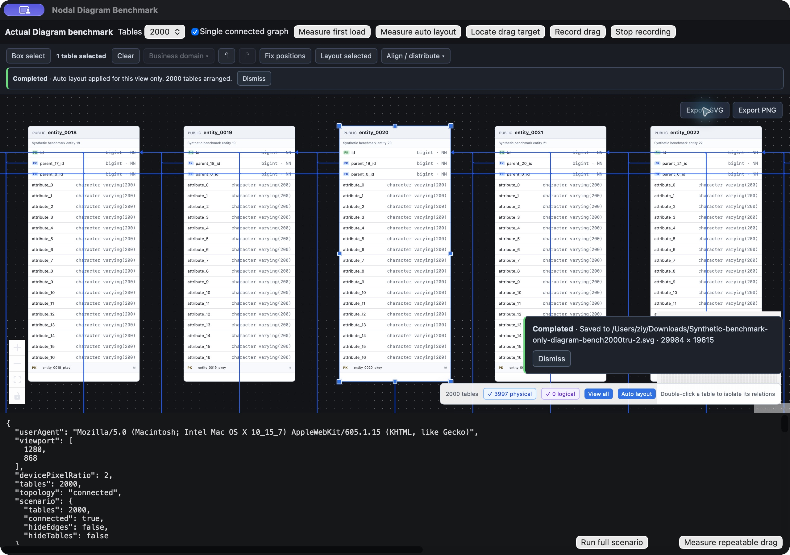
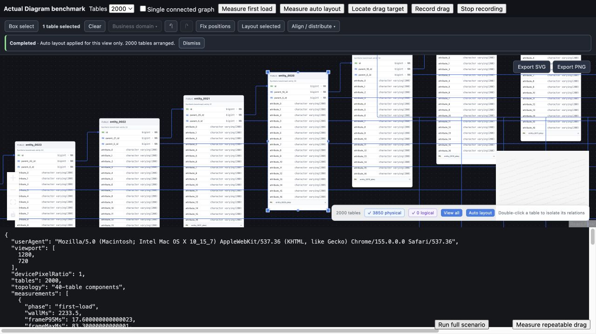
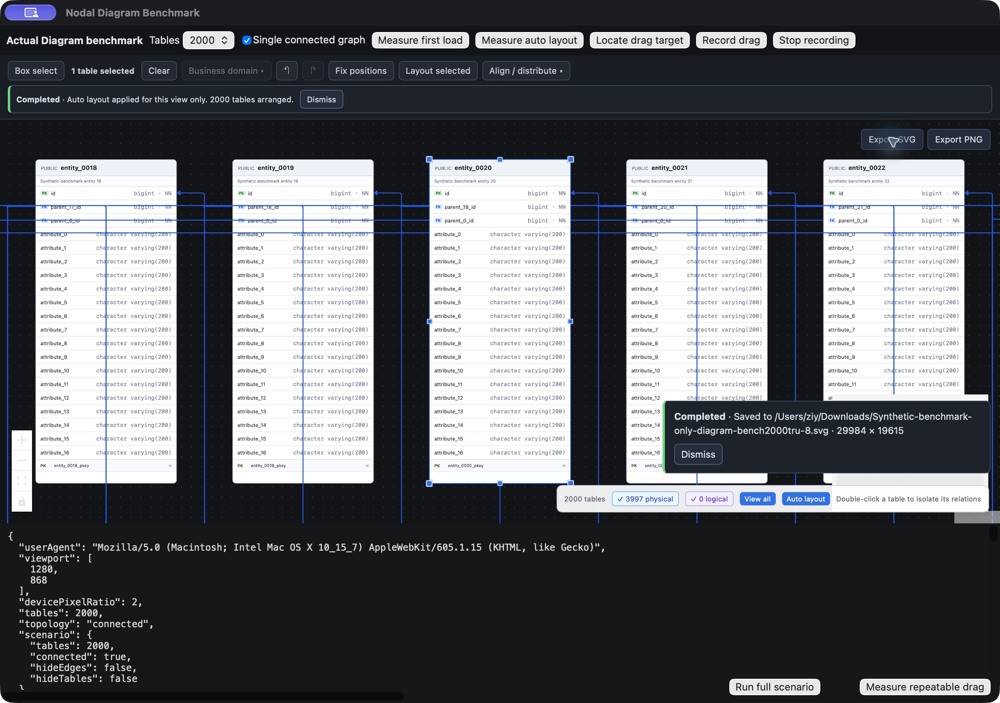
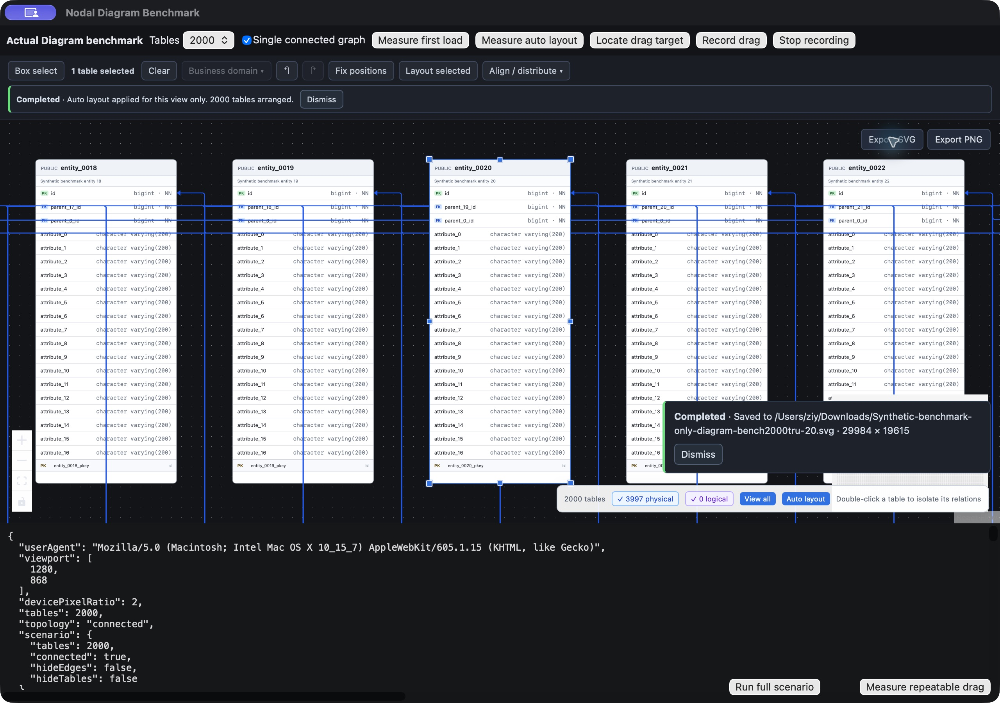
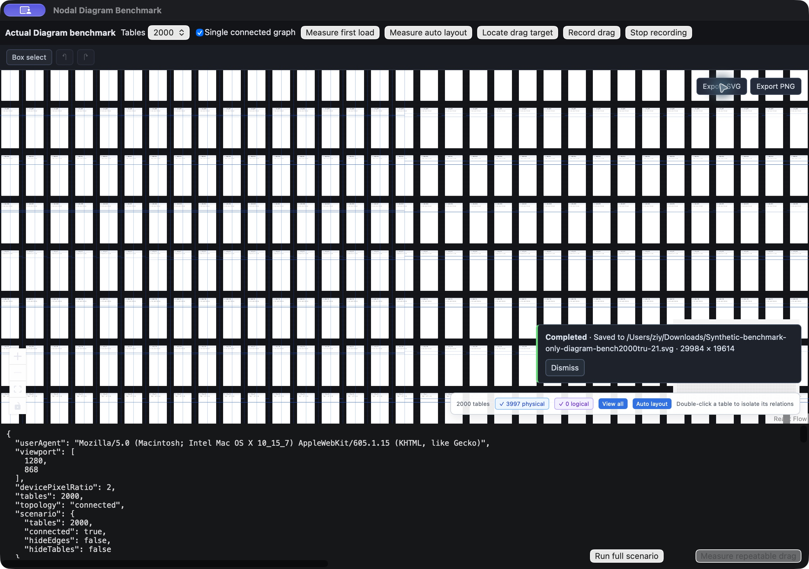
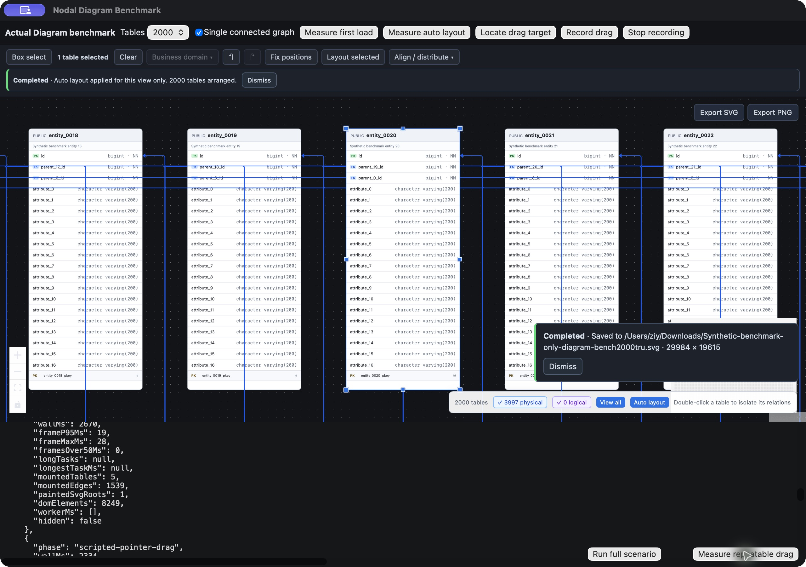
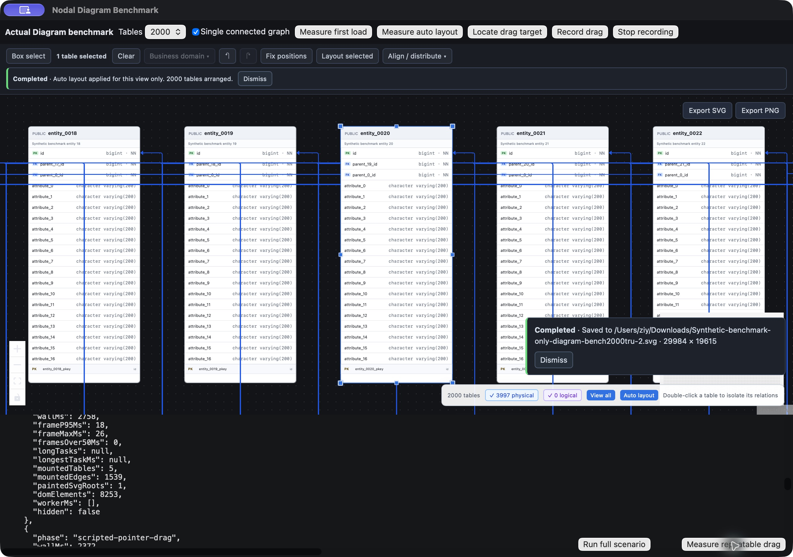

# 千表场景性能验证

日期：2026-10-15；完整 SVG 导出与最终构建补测：2026-10-16。使用独立生产构建入口 `apps/frontend/diagram-benchmark.html`，加载实际 SchemaCanvas、React Flow、节点组件与真实 Worker。没有模拟 DOM、模拟布局结果或数据库访问；模型由确定性合成数据生成。原始采样在 [performance/diagram-2026-10-15.json](./performance/diagram-2026-10-15.json)。

## 场景与口径

- 1,000 表 / 20,000 字段 / 1,925 外键，按 40 表组成连通组。
- 2,000 表 / 40,000 字段 / 3,850 外键，同样按模块分组。
- 2,000 表 / 40,000 字段 / 3,997 外键，单一连通组，包含长链与指向公共表的长边。
- 每张表含主键、索引和注释。另有回归覆盖循环、不同尺寸、固定位置和选区布局。
- 首次加载：从创建并挂载模型计时，到布局、完整关系绘制可操作，再等待 350 ms 收尾。包含构图、初次 React/DOM 工作、Worker、相机适配；不包含网络下载、软件进程启动、数据库采集和用户磁盘 I/O。
- 自动布局：从触发实际按钮到成功反馈及约 32 ms 收尾窗口；记录 Worker 往返和主线程帧间隔。Worker 往返也可能包含主线程处理消息的排队时间，不等同于纯算法 CPU 时间。
- 固定拖动：实际渲染引擎中发送 6 次往返、每次 15 个鼠标移动事件（90 步），每步等待一帧，验证每次表的 transform 确实改变。它是可复现的真实 DOM/React Flow 事件测试，不是操作系统原生输入；另外使用浏览器真实指针拖动交叉验证。计时不包含定位目标和操作间的人工等待。
- 帧间隔来自 requestAnimationFrame；Chrome 另采集 Long Tasks。WebKit 不支持该观察类型时记录 null，不能解释成没有长任务。阶段单次结果；共享 SVG 修复另做连续三轮，未开 CPU 限速；显示器/窗口状态、常驻程序、浏览器与桌面引擎差异均会影响数值，不能据此声称固定帧率。

## 结果

解锁后的最终构建复测已完成，包含共享 getState 批次键修正。原生 WebKit 窗口为 1280 × 868 CSS 像素，Chromium 155 最终窗口为 1280 × 720 CSS 像素，均为 devicePixelRatio=2、页面可见。早期阶段浏览器窗口为 642 × 954；不同视口、引擎和阶段的数值不混用作提速比例。

| 引擎 / 场景 | 首次加载 | 自动布局 | 拖动帧间隔 P95 / 最大 |
| --- | ---: | ---: | ---: |
| Chromium / 1,000 表模块图 | 1.43 s | 0.84 s | 17.3 / 17.7 ms |
| Chromium / 2,000 表模块图 | 2.26 s | 1.46 s | 17.5 / 33.4 ms |
| Chromium / 2,000 表单连通图 | 1.23 s | 0.20 s | 33.5 / 83.4 ms |
| 原生 WebKit / 2,000 表模块图 | 2.33 s | 1.70 s | 22 / 87 ms |
| 原生 WebKit / 2,000 表单连通图（修复前） | 稳定性失败 | 未取得稳定样本 | 未取得稳定样本 |

四组完整采样的 6 次/90 步移动均全部生效，并等待完整关系恢复。首次加载、自动布局均为上述画布操作口径，不是应用启动或数据库采集耗时。2,000 表模块图初始只挂载 45 张表（原生）/31 张表（Chromium），保留完整 2,000 表模型。

2,000 表单连通图、6 次/90 步拖动：帧间隔 P95 **133 → 50 ms**，最大帧间隔 **183 → 83 ms**，Chrome Long Tasks **37 → 6**。6 次移动全部生效；暂时移出渲染的 1,508 条无关关系恢复后，视口再次有 1,511 条关系，与测试前一致。P95 包含松开后的分帧恢复，不是只截取平稳移动片段。

以上 133 → 50 ms 对照属于同一早期视口的关系订阅裁剪阶段。最终大视口 33.5 ms 单独列出，不能与其直接计算提速比例。测量批次使用共享 getState 函数识别画布，回归覆盖同一 store 的不同包装对象。

## 原生密集图稳定性：共享 SVG 修复后通过

2,000 表单连通图在原生窗口曾产生 1,117 ms 的加载记录，但随后 WebContent 进程崩溃，窗口回到初始画面。因此该记录仅作诊断，**不计作稳定加载通过**，也不能用 Chromium 的布局/拖动数字替代原生结果。

本机诊断报告确认进程归属 `com.claycosmos.nodalstudio.benchmark`，系统为 macOS 27.0.1 / WebKit 22625.1.29.11.28；故障线程停在 `IPC::Connection::sendMessage` 与 `retrySendMessageWithSharedMemory`，错误码为 `MACH_SEND_TOO_LARGE`，一份报告的主线程处于 SVG marker 绘制。曲线路径裁剪、概览隐藏箭头、将每帧新增关系从 250 降至 64，均未消除崩溃，已全部撤回。另用 Run full scenario 连续运行三阶段、期间不读取完整辅助功能树，仍复现崩溃，故不能只归因于检查工具。

[WebKit 上游相关 IPC 修复](https://results.webkit.org/commit?id=319119%40main&repository_id=webkit) 涉及大量消息附件，但本次具体消息和触发机制尚未定位，不能认定与上游问题完全相同。原始记录保留了不含用户身份信息的关键堆栈。上述是修复前证据。进一步对照中，仅隐藏关系绘制、保留完整模型与 DOM，原生三阶段能够完成，故改为共享绘制层：React Flow 继续维护每条关系的模型、端口、订阅和可见性，实际路径集中到一个 SVG；原包装 SVG 为空且退出辅助功能树。保留全部关系、箭头、虚线、比较偏移、标签、键盘选择、详情与逻辑关系双击编辑，并按推断/普通/选中分组维持层级。导出跳过空包装，防止关系重复。此证据支持该绘制组织方式可避开本机故障，不能据此认定上游 IPC 的具体实现原因。没有修改操作系统配置或缩减用户可查看的关系。

### 共享绘制层的实际原生结果

相同 1280 × 868 / DPR=2 原生窗口，关系与表绘制始终开启。初版共享绘制层连续三轮均完成加载、真实布局 Worker 和 6 次/90 步拖动：

| 轮次 | 首次加载 | 自动布局 | 拖动帧间隔 P95 / 最大 |
| --- | ---: | ---: | ---: |
| 1 | 1.095 s | 0.336 s | 46 / 72 ms |
| 2 | 1.296 s | 0.175 s | 32 / 71 ms |
| 3 | 1.219 s | 0.299 s | 39 / 76 ms |

加入推断关系底层分组后的再次确认：加载 1.101 s、布局 0.300 s、拖动 P95 / 最大 38 / 77 ms。上述场景均为物理关系，分组补充不改变其绘制路径。每轮 6 次移动全部生效；拖动期间最多暂卸 1,536 条无关关系，结束后无残留，视口恢复 1,539 条实际路径。模型始终保留完整 2,000 表 / 3,997 关系；只挂载视口相关路径，绘制 SVG 根节点数为 1。不同阶段的模型/DOM 数量已分别记录，不把空 SVG 包装计作实际绘制路径。

最终源代码的模块图回归：加载 2.267 s、布局 1.469 s、拖动 P95 / 最大 18 / 20 ms，6 次移动生效，恢复后无残留。2026-10-15 的最后追加轮次曾被自动锁屏阻断读取；2026-10-16 已用最终构建重新补测，见下节。标准桌面构建、434 项测试、类型检查和 lint 已完成。修复后的主交互逻辑与上述密集图通过轮次一致；完整导出的诊断实验已撤回。

本机现有六份 WebKit 崩溃报告均属于修复前（最后为 19:28:28），在报告根目录与 Retired 中未发现修复后新增报告。连续通过只证明此夹具和本机环境下不再复现原崩溃，首次加载仍有长帧，不能承诺所有硬件/拓扑无卡顿。

布局策略的阶段对照：先移除全量 DOM 测量依赖后，1,000 表在同一 Chromium 页面仍用 14,946 ms，其中 Worker 往返 14,386 ms；进一步降低大模型布局搜索开销后，降至 1,434 ms / 954 ms。此对照只反映第二阶段布局优化，不能当作整个软件的冷启动提速比例。最初全量挂载版本的运行一度阻塞检查请求，未取得可靠完成采样，不给出推算数值。

2,000 表单连通图在分帧挂载关系 SVG 前用 2,503 ms，最大帧间隔 950 ms；分帧后同一浏览器、同一视口用 1,751 ms，最大帧间隔 400 ms。说明绘制峰值已降低，但极密图初次绘制仍存在长帧，不能声称完全无卡顿。

## 实施

- 大图从首帧裁剪离屏节点，已知固定卡片大小和临时端口先声明；详细卡片挂载后批量测量、修正并撤去临时声明，避免后续拖动重新覆盖实际锚点。
- 节点测量按画布、按提交合并，选中/关系高亮数据在坐标变化时复用；TableNode 只比较实际使用的属性。
- 连通组划分及布局结果查找改成索引；大模型中的小组降低 ELK 搜索开销；200+ 表连通组采用邻接顺序紧凑排布，避免长边生成二次规模中间节点。它优先保证计算有界与卡片不重叠，不保证最少交叉或严格父子分层。
- 初始关系 SVG 按帧挂载；切图取消旧序列。高密图拖动时仅挂载相关关系，保留完整关系模型，松开后按帧恢复；导出等待恢复完成，再包含全部节点、关系和字段。仅用 CSS 隐藏路径未改善性能，因此最终改为减少 React Flow 的无关关系订阅。大图全图适配避免长缩放动画引发重复挂载。
- 布局固定/选区范围、避让、撤销、保存、只读边界和导出完整性仍由原有流程处理。

## 复现

```sh
pnpm --filter @nodalstudio/frontend benchmark:build
pnpm --filter @nodalstudio/frontend benchmark:preview
# 打开 http://127.0.0.1:1421/diagram-benchmark.html
```

保持页面可见，选择表数量/连通方式，执行 Measure first load、Measure auto layout、Locate drag target、Measure repeatable drag。先保存结果再切场景。测试入口独立于常规 index.html，不进入发布应用；可通过 NODAL_BENCH_OUT 覆盖构建目录。原生测试使用相同生产资源及独立 bundle identifier 的 Tauri 测试窗口，不覆盖用户数据源、布局或凭据。

默认选择 2,000 表；Run full scenario 可连续执行加载、自动布局、定位、拖动，避免阶段之间的界面检查影响测试。Scenario samples 为最近三次独立的紧凑记录；另保留当前阶段的本地 trace，便于识别进程重置或长时间阻塞。绘制隐藏开关仅作诊断，正常复测均关闭。

最终代码通过 434 项测试（81 个文件）、类型检查、lint 和标准桌面构建。新增回归包括 2,000 条路径共享一个 SVG、比较标记/箭头/标签、交互与键盘，以及真实 React Flow 的 500 表/1,000 关系完整模型、导出唯一性、筛选重建和选择焦点。单元测试不能代替原生复测。

### 2026-10-16：完整 SVG 导出与恢复修复

修复前，2,000 表 / 40,000 字段 / 3,997 关系的完整导出在 capture 返回后的恢复提交中持续占用一个 CPU 核，WebContent 内存约 4 GB，无法取得保存回执；采样含 ContainerNode::removeChild。隔离 XML、单独改轻量序列化、辅助功能隐藏、整体 display:none 均未解决。这些历史失败保留在 2026-10-15 原始记录中。

最终实现不再一次展开/卸载全部字段：全图节点先以概览挂载，每批最多展开 32 张表并累积采集。导出详情通过按表订阅通知，仅更新进出批次的节点；最后先折叠最后一批、再恢复视口裁剪、再重置订阅，避免同步订阅提前重新展开整图。完成和异常路径均恢复交互，过程中保留全部关系及标记，过滤/聚焦/业务域范围沿用当前 Diagram。

SVG 输出改为轻量数据树，文字样式共享、空分组省略、几何精度统一到 0.01 像素。仅实际溢出的内容保留裁剪框，避免为所有设置 overflow 的元素重复生成裁剪。诊断中未压缩文件约 52 MiB；最终保留全部对象的实际文件为 **22,803,013 字节**，仍执行原有 32 MiB 限制，未提高限制或丢弃字段。文件直接经原生 save_diagram_export 保存到 Downloads；额外用 XML 解析与 SHA-256 校验真实磁盘文件，确认 2,000 个唯一表、40,000 个唯一表/字段对及可见名称、3,997 条唯一关系和 3,997 个箭头，没有外部资源或脚本。

初次完整导出/验证/恢复耗时 21.584 s；恢复后继续 6 次/90 步拖动全部生效，再次自动布局完成。从全图视角重复导出 18.793 s、22,679,267 字节，仍保留 40,000 字段和全部关系。两次峰值详细表数均为 32，视口与选择恢复均通过。以上出口测量包含测试端 XML 解析和验证，不含磁盘保存 I/O；图的概览视角会影响裁剪与文字几何，故两次文件字节数略有不同。

导出仍有明显计算成本：上述两次帧间隔 P95 为 326 / 248 ms，最大为 1,378 / 1,272 ms。分批工作和序列化没有变成 Worker 任务；不能声称导出全程无长帧，也不把不再持续阻塞解释成即时导出。PNG 共用完整捕获流程，原像素上限保留；本次大图实际文件复测针对 SVG。

最终生产代码的三轮原生密集图补测（同一窗口，DPR=2，未运行构建/测试任务）：

| 轮次 | 首次加载 | 自动布局 | 拖动帧间隔 P95 / 最大 |
| --- | ---: | ---: | ---: |
| 1 | 1.179 s | 0.238 s | 52 / 102 ms |
| 2 | 1.443 s | 0.233 s | 38 / 79 ms |
| 3 | 1.314 s | 0.212 s | 37 / 73 ms |

最终构建 2,000 表模块图另完成加载 2.253 s、布局 1.448 s、拖动 P95 / 最大 18 / 21 ms 的回归，6 次移动全部生效。

密集图 18 次/270 步拖动全部生效，松开后无暂卸残留，视口路径恢复为 1,539 条。最终生产代码的一次带原生 XML 校验慢样本用时 84.639 s，恢复阶段 1.525 s，保存成功，不能丢弃该慢样本。最终测试入口移除了应用内 DOMParser，避免额外构建一棵原生 SVG 树：时钟在 saveDiagramExport 入口停止，XML 验证改为对已保存文件独立进行。

独立验证入口实测 **21.624 s**（不含校验及原生磁盘保存），其中恢复阶段 **2.933 s**，包含折叠末批、恢复裁剪、等待画面提交及重置订阅。最终文件与先前完成全部 XML 校验的文件 SHA-256 完全一致。导出后又完成 6 次/90 步拖动，P95 / 最大 46 / 89 ms；视口和选择保持，峰值详细表数仍为 32。

资源限制仍明显：独立验证版导出前 WebContent RSS 约 885 MiB，导出后一次读数约 3.95 GiB，桌面进程约 1.04 GiB；这些是时点 RSS，不是峰值或存活对象总量。含原生 XML 校验的慢样本读数约 5.35 GiB。不能据此断言全部差异都由解析引起；生成、数据准备和原生数字数组传输仍有较高内存成本。修复保证此夹具能完成恢复并继续操作，不承诺全程无卡顿或低内存。

最终构建的原生重复采样、恢复阶段计时、真实文件校验和截图见 [diagram-2026-10-16.json](./performance/diagram-2026-10-16.json)。测试覆盖按表订阅隔离、完整批次采集、异常恢复、真实 React Flow 模型/关系保留、转义、UTF-8 大小边界和实际溢出裁剪。434 项测试、类型检查、lint、标准桌面构建均通过。



额外验证了 Run full scenario 的完整三阶段入口：显式 1280 × 720 视口（该覆盖模式 DPR=1），加载 2.23 s、布局 1.42 s、拖动 P95 16.8 ms。该轮和下图单独记录于 fullScenarioControl，不与主表 DPR=2 数据混算。



### 2026-10-16 后续：定位 85 秒慢样本，完整 SVG 降至约 5.4 秒

本节为上述 19–85 秒记录之后的新一轮优化；历史失败与慢样本继续保留。最终生产 Vite 资源装入隔离的 Tauri debug app，在原生 WKWebView、1280 × 868 CSS 像素、DPR=2 下实测 2,000 表 / 40,000 字段 / 3,997 关系的单连通密集图。所有诊断隐藏开关关闭，测量时没有并行构建或测试，不改动用户数据源和原布局。

**85 秒样本不能只归因于测试端 DOMParser。** 移除应用内 XML 解析后，旧实现仍复现 **98.497 秒**慢样本。新增阶段计时表明 capture 用时 93.995 秒，63 次批次切换合计 90.251 秒，而实际文字/HTML 读取合计仅 1.472 秒、最终序列化 325 毫秒。批次计时包含读取，capture 包含恢复，各项不能直接相加。

原生 WebContent 一秒只读采样的热点为 `ContainerNode::removeChild → boundaryNodeWillBeRemoved`。旧实现每次文字测量都创建一个 DOM Range；这些注册在文档中的 Range 在 GC 前持续参与后续节点移除的边界维护，造成批次卸载成本随文字数量增长。对照实验仅暂停交互几何更新并改二进制传输，仍耗时 62.143 秒，恢复单项甚至用时 22.273 秒；再改为每次捕获共用一个 Range 后降至 **5.826 秒**，输出字节完全一致。这支持 Range 边界维护是此次慢样本的主要原因，不能将全部提速归功于 IPC 或文件序列化。

最终进一步实施：每批 16 表、一次动画帧提交；导出阶段暂停交互端口测量和关系几何更新；空详情覆盖保留至视口裁剪提交后；按表立即序列化并释放临时向量树；字体声明缓存；通过 Uint8Array 原始二进制 IPC 保存，避免数千万个 JSON 数字。旧数组接口兼容，文件名、格式、内容、32 MiB 上限和独占创建检查继续执行。PNG 共用捕获/二进制通路并有回归测试，本轮实际大图磁盘复测针对 SVG，原 PNG 像素上限不变。

本轮计时覆盖捕获、恢复、字节准备、轻量对象清点和**实际原生磁盘保存**，比上节 85 秒样本多包含保存 I/O；因此采用同一新测量入口的 98.497 秒基线作直接对照，不把历史两种口径混算。`preparedWallMs` 另记录进入清点/保存前的耗时。XML 校验在保存后独立进行，不进入应用内计时。WebKit 未提供 Long Tasks API，长任务字段为 null；表中的帧间隔来自 requestAnimationFrame，不能解释为 Long Tasks 数量。

| 最终轮次 | 完整导出与实际保存 | 帧间隔 P95 / 最大 | 超过 50 ms 的帧间隔 | 恢复阶段 | 原生保存 |
| --- | ---: | ---: | ---: | ---: | ---: |
| 新进程首次导出 | 5.404 s | 52 / 587 ms | 8 | 381 ms | 63 ms |
| 三次热加载后导出 | 5.449 s | 59 / 559 ms | 8 | 450 ms | 26 ms |
| 同图再次导出 | 5.221 s | 44 / 490 ms | 6 | 372 ms | 20 ms |

基线为 P95 / 最大 **2,804 / 3,298 ms**、106 个超过 50 ms 的帧间隔。最终单批最大 62–68 ms，125 批合计 3.963–4.107 秒，其中读取 1.428–1.469 秒；最终拼接/序列化 20–23 ms，字节准备 53–62 ms。图全量概览挂载仍用时 543–638 ms，恢复仍用时 372–450 ms，**仍有明显长帧，不代表无卡顿或稳定 60 FPS**。

三次真实磁盘文件均为 **22,803,013 字节**，独立 XML 解析确认 2,000 个唯一表、40,000 个唯一表/字段对及可见名称、3,997 条唯一关系与 3,997 个箭头；关系图例、主题保留，无脚本和外部资源。三份文件 SHA-256 均为 `3790e495cd1a0f6a21e50a200db95c1d1492b5f510f6e1a4e94c63d77ae7c22b`，与旧慢样本文件完全一致。峰值详细表数均为 16，视口与选区恢复均通过。

首次导出的 30 秒窗口按目标 0.2 秒间隔读取 RSS：WebContent 采样最大 **1,480,000 KiB（1.41 GiB）**，桌面进程 **214,624 KiB（209.6 MiB）**。三次热加载后的重复导出采样窗口最大分别为 **2,050,832 KiB（1.96 GiB）** 和 **214,960 KiB（209.9 MiB）**。旧 98.497 秒慢样本结束后的时点读数分别为 **5,134,448 KiB（4.90 GiB）** 和 **1,090,304 KiB（1.04 GiB）**。新数据是窗口内采样最大值，旧数据是结束后单次读数，均不是精确峰值或存活对象量；保留原始时序，不将其混称为相同口径峰值降幅。热加载后 RSS 高于新进程首次导出，不能声称内存已回落至初始值或据此证明没有泄漏。

最终构建三轮热加载复测：

| 轮次 | 首次加载阶段 | 自动布局 | 6 次/90 步拖动 P95 / 最大 |
| --- | ---: | ---: | ---: |
| 1 | 1.454 s | 0.206 s | 56 / 90 ms |
| 2 | 1.438 s | 0.170 s | 40 / 81 ms |
| 3 | 1.469 s | 0.165 s | 35 / 83 ms |

三轮共 18 次移动全部生效，松开后无暂卸关系残留。最后一次导出后另完成 6 次/90 步拖动，P95 / 最大 52 / 82 ms，恢复 1,539 条视口关系；再次自动布局 308 ms、Worker 43 ms，未触发阻塞。检查 DiagnosticReports 根目录和 Retired，仍只有原先六份 WebKit 崩溃报告，未发现本轮新增报告。这些结果限于本机夹具及观察窗口，不作所有硬件、拓扑和无限重复运行的稳定性承诺。

最终通过 **439 项前端测试（82 文件）、14 项桌面 Rust 测试**、类型检查、lint、Clippy（warnings denied）、fmt、标准桌面构建与隔离原生测试构建。新增/扩展测试覆盖单 Range 跨批次复用及换行文字、字体声明缓存、片段转义和累计 UTF-8 上限、导出期间测量暂停与恢复覆盖生命周期、完整模型/对象唯一性、Uint8Array 原始字节及子数组、旧数组兼容、原生格式/路径/大小拒绝及不覆盖已有文件。

完整阶段采样、消融对照、RSS 时序、文件校验和后续操作记录见 [diagram-svg-2026-10-16.json](./performance/diagram-svg-2026-10-16.json)。以下为最终原生实际保存成功、2,000 表与 3,997 关系仍可见的截图：



### 2026-10-16 后续：消除全量概览挂载/卸载，降低 490–587 ms 长帧

上节最终实现虽然限制了完整字段批次，仍先挂载全部 2,000 张概览卡片和关系，恢复时再整体移除视口外对象；这两次提交仍形成明显峰值。试验先分批切换 React Flow 的 hidden 属性，实测反而用时 18.459 秒、P95 228 ms，并且尚未全部提交的关系只采到 3,843 条。该试验未达完整性与性能要求，已全部撤回，失败结果保留在本节原始记录中，不计为通过样本。

最终实现将导出 DOM 生命周期与交互画布分离。100+ 表时在独立、透明、不可交互但可测量的导出层中，每次仅挂载 **16 张完整卡片或 64 条关系**，立即采集并释放。交互画布始终保持视口裁剪和完整模型，不因导出改变节点/关系数组、坐标、尺寸、选择、端口缓存或保存布局。清理只移除末批内容；无需挂载再卸载 2,000 张概览卡片。

导出层复用实际 TableNode、ComparisonEdge、当前主题/设置、比较版本和 React Flow 的端口计算，关系标签等待其测量提交后才读取；可见卡片手动展开的索引状态保留。文字仍共用一个 Range、片段及时序列化，原二进制传输、32 MiB 上限与 PNG 像素限制保持。缺少几何、身份重复、未采集完全部表/关系或图范围改变时明确失败并清理，避免静默遗漏对象。小图继续原地采集并保留活跃关系端口，只有独立导出副本省略端口与尺寸手柄；末次兼容性核对已补充相应断言和原生确认。此次增加了 @xyflow/system 的直接依赖，锁定为当前 React Flow 已使用的同一个 0.0.79 版本，复用其端口和 marker ID 算法，没有新增另一份布局/端口算法。

最终生产 Vite 资源、隔离 Tauri debug app、原生 WKWebView，1280 × 868 / DPR=2，2,000 表 / 40,000 字段 / 3,997 关系单连通密集图。绘制诊断开关关闭，测量期间无并行构建或测试。耗时与上节最终样本口径一致，包含捕获、恢复、字节准备、轻量清点和实际原生磁盘保存：

| 场景 | 完整导出与保存 | 帧间隔 P95 / 最大 | 超过 50 ms 的间隔 | 挂载阶段总时长 | 恢复阶段总时长 |
| --- | ---: | ---: | ---: | ---: | ---: |
| 新进程首次近景导出 | 3.886 s | 26 / 161 ms | 2 | 150 ms | 47 ms |
| 热加载后近景导出 | 3.890 s | 27 / 182 ms | 2 | 155 ms | 50 ms |
| 同图重复近景导出 | 3.864 s | 27 / 188 ms | 2 | 158 ms | 53 ms |
| 自动布局后全图概览导出 | 4.166 s | 28 / 176 ms | 4 | 215 ms | 228 ms |
| 小图端口兼容性修复后，新进程确认 | 3.959 s | 28 / 96 ms | 2 | 112 ms | 52 ms |

近景挂载阶段跨帧最大间隔 **65–119 ms**；概览挂载最大 **176 ms**。前三轮 63 个关系批次最大 20–27 ms，125 个表批次最大 30–33 ms，表读取合计 1.147–1.169 秒。全图概览仍保留 264 张视口卡片 / 1,214 条视口关系，近景为 5 张 / 1,539 条；导出层最多只出现 16 张详细卡片，不能把该值解释为交互画布也只保留 16 张表。

原先近景挂载 **543–638 ms**、恢复 **372–450 ms**，本轮分别为 **112–158 ms**、**47–53 ms**。概览视角下已有视口内容更多，恢复用时 228 ms、跨帧最大间隔 166 ms，仍不是零成本。近景整体最长帧已经转移到字节准备，76–173 ms 的字节阶段对应 96–188 ms 的帧间隔；拼接/序列化仍为 18–20 ms。阶段帧窗口采用“与测量区间有交集”的记录口径，一帧可能同时出现在两个相邻区间：第三轮 188 ms 字节帧也跨过恢复区间末尾，不能因此把 188 ms 全部归为只有 53 ms 的恢复阶段。所有阶段总时长也有嵌套，不能简单相加。WebKit Long Tasks 字段仍为 null；以上是动画帧间隔，不是 Long Tasks 统计。

五份实际磁盘 SVG 分别为 21,412,062 / 21,361,205 / 21,361,205 / 21,359,060 / 21,440,967 字节，全部低于原 32 MiB 上限。独立 XML 解析确认各有 2,000 个唯一表、40,000 个唯一表/字段对和可见字段名、3,997 条唯一关系及 3,997 个箭头；主题与关系图例保留，所有 marker 引用解析成功，路径数值有限，没有脚本或外部资源。两次同图重复文件 SHA-256 完全相同。

前三份及末次确认文件的 **2,000 张表向量子树逐一与上节实际文件完全一致**。全图概览换视角后，表文本和元素数全部相同，表几何最大差异 0.01 px，文件高度因边界取整差 1 px。新导出直接使用当前画布的缓存/临时端口，旧导出会因全量挂载而重新测量离屏端口；与旧文件比较，关系路径命令完全相同、最大数值坐标差约 1.0001 px。组件测试另验证新路径与当前画布缓存端口计算的结果严格相同。交互辅助功能元数据、marker 实例 ID、属性顺序及视角取整可能改变文件校验和，不能继续声称新版与旧版文件字节相同；这也不是删除字段换取提速。

新进程首次导出及随后一次热加载的 30 秒窗口，WebContent RSS 采样最大 **995,184 KiB（0.95 GiB）**；同图重复导出窗口最大 **1,003,152 KiB（0.96 GiB）**，桌面进程约 204 MiB。目标采样间隔 0.2 秒，保留实际采样时刻。这是窗口内 RSS 采样最大值，不是精确峰值或存活对象量；不能与上节三次热加载窗口的 1.96 GiB 当作同样压力序列直接计算降幅，也不能据此证明长时间运行没有泄漏。

最终构建的两次全场景验证：加载 1.202 / 1.358 秒，自动布局 285 / 227 ms，6 次/90 步拖动全部生效，P95 / 最大分别 31 / 76、47 / 88 ms。末次兼容性修复后用新进程再次完成加载 1.217 秒、布局 400 ms、6 次/90 步拖动 P95 / 最大 44 / 95 ms，并完成第五轮真实磁盘导出。第五轮导出后又完成 6 次/90 步拖动，P95 / 最大 53 / 77 ms；再次布局 403 ms、实际 Worker 44 ms。视口、选择及关系恢复通过，未残留暂卸关系。复查 DiagnosticReports 根目录及 Retired，仍仅有原六份历史 WebKit 崩溃报告，未发现本轮新增报告。上述稳定性结论限于本机夹具和观察窗口。

通过 **442 项前端测试（83 文件）**、类型检查、lint、标准桌面构建及隔离原生测试构建。本轮新增/扩展回归覆盖真实完整模型不变、交互画布始终裁剪、导出层表/关系批次数量、全部身份完整且唯一、比较字段/关系/标签/偏移、当前端口路径、手动索引展开、缺失几何的正常错误路径、末批清理和异常恢复。Rust 源码本轮未变。

完整阶段时长、跨阶段帧窗口、失败试验、RSS 时序、文件 SHA-256 及逐对象对照见 [diagram-svg-batches-2026-10-16.json](./performance/diagram-svg-batches-2026-10-16.json)。本轮最长帧仍为 96–188 ms，尤其字节准备及概览交互恢复；不承诺全程无卡顿或稳定 60 FPS。


### 2026-10-16 后续：分块直接编码，保留概览画布的组件与辅助功能树

上一轮 SVG 字节准备仍采用 `string → Blob → arrayBuffer → Uint8Array`，近景阶段出现 96–188 ms 的帧间隔，概览单轮为 61 ms；概览恢复总耗时 228 ms，对应最大帧间隔 166 ms。源代码还会在导出前后切换主画布的 inert/aria-hidden、节点可拖动状态及交互上下文，即使没有全量 DOM 卸载，仍会影响可见卡片和辅助功能树。

本轮 SVG 序列化复用已计算的 UTF-8 大小，直接分配最终 IPC 字节缓冲区；每次最多编码 128 Ki UTF-16 字符，用 TextEncoder.encodeInto 写入，累计约 8 ms 后让出一帧，不拆分代理对。取消检查贯穿批次，错误的大小元数据、超过 32 MiB 或不足的缓冲区明确失败，不输出截断文件。没有字节元数据的兼容调用仍限制预算。SVG 字节准备不再经过整份 Blob/arrayBuffer 往返；PNG 保留原栅格化、Blob 和像素上限。片段序列化也直接返回已计算的字节数，避免重复编码同一个片段只为计数。

大图保持原交互上下文、节点交互订阅和辅助功能树，使用 aria-disabled、工具栏禁用及输入捕获守卫暂停画布操作，允许 Tab 导航与导出反馈；被动滚轮/触控事件仅阻止传播，不调用 preventDefault。小图仍按原地捕获路径保留端口与 inert 隔离。真实 React Flow 回归断言导出期间可见节点 DOM 身份、渲染次数、模型、位置和选区不变，鼠标与键盘动作被阻止，结束与异常后恢复。导出层只清理末批内容。

4 ms 预算原型的字节阶段帧间隔为 25 ms，但阶段总时长约 244 ms。最终采用 8 ms 预算，在主线程响应与等待帧开销之间取折中；4 ms 与 8 ms 原型的同一概览 SVG 文件字节完全一致。计时继续包含捕获、恢复、字节准备、测试端轻量清点与实际原生磁盘保存；XML 验证在保存后独立进行。生产 Vite 资源、隔离 Tauri debug app、原生 WKWebView、1280 × 868 / DPR=2，2,000 表 / 40,000 字段 / 3,997 关系，所有绘制诊断开关关闭，采样期间没有并行构建或测试：

| 场景 | 完整导出及保存 | 整体 P95 / 最大帧间隔 | 字节准备总时长 / 最大帧间隔 | 恢复总时长 / 最大帧间隔 |
| --- | ---: | ---: | ---: | ---: |
| 新进程首次概览导出 | 3.984 s | 26 / 110 ms | 85 / 25 ms | 37 / 46 ms |
| 同一概览重复导出 | 4.356 s | 31 / 130 ms | 98 / 31 ms | 21 / 42 ms |
| 重载后概览导出 | 4.146 s | 30 / 119 ms | 110 / 40 ms | 27 / 48 ms |
| 完整加载/布局/拖动后的近景导出 | 3.799 s | 26 / 63 ms | 82 / 22 ms | 52 / 44 ms |

上述四轮的**字节准备和恢复阶段均未观测到超过 50 ms 的帧间隔**。概览挂载阶段为 26–38 ms；恢复中末批清理为 1–2 ms，交互恢复与等待提交为 19–36 ms。最终缓冲区分配读数 0–1 ms，163–164 个 UTF-8 块的累计编码读数 52–55 ms，单块最大读数 1 ms；0 ms 表示低于时钟分辨率，不能解释为零成本。字节阶段总时长含主动等待帧，不能拿其 82–110 ms 总耗时当作单帧阻塞。

整体导出仍有 **63–130 ms** 长帧，主要落在关系/表捕获批次；概览重复轮不能因为最慢而丢弃。该轮 4.356 秒也高于上一轮部分样本，不能声称总耗时在所有轮次都减少。此优化主要改善目标阶段的响应性，并不保证整次导出无卡顿或稳定 60 FPS。阶段帧窗口仍以“与阶段区间相交”计入，相邻阶段可能共享边界帧，例如序列化帧同时落入恢复开头；嵌套时长不能相加。WebKit Long Tasks 仍不可用，字段为 null。

三个概览文件均为 **21,313,428 字节**，SHA-256 均为 `309a9d6acabdf7c2dd3f6dcc4324e29bb73f37ca66e03b35d70ac294ae91bbe7`；近景文件为 21,437,291 字节。四份实际文件均通过独立 XML 解析，分别含 2,000 个唯一表、40,000 个唯一表/字段对和可见字段名称、3,997 条唯一关系及 3,997 个箭头；主题、关系图例保留，marker 引用全部解析，路径数值有限，没有脚本或外部资源。视口与选区恢复均通过，导出层最多 16 张详细卡片。字节编码预算改变没有改变同图输出，不通过删减字段或提高限制换取性能。

概览导出阶段的 30 秒窗口按目标 0.2 秒间隔读取 RSS，WebContent 采样最大 **935,968 KiB（约 0.89 GiB）**，桌面进程 **208,656 KiB（约 204 MiB）**。这是窗口内采样最大值，不是精确峰值、存活对象量或泄漏证明，也不是对上一轮不同视角/热加载序列的严格内存对照。

最终全场景加载 1.406 秒、自动布局 369 ms，6 次/90 步拖动全部生效，P95 / 最大 41 / 85 ms。近景导出后再完成 6 次/90 步拖动，P95 / 最大 45 / 83 ms，暂卸关系无残留；再次布局 482 ms、实际 Worker 47 ms，帧间隔最大 37 ms。加载和布局仍有成本：另一次热重载记录最大 367 ms 帧间隔，全场景初次布局为 295 ms，均保留在原始记录，不能将这些阶段也描述为无长帧。诊断目录仍只有原六份历史 WebKit 崩溃报告，未发现本轮新增报告。

通过 **446 项前端测试（85 文件）**、类型检查、lint、标准桌面及隔离原生测试构建；被动触控守卫补充核对后，相关 4 项测试再次通过。新增/扩展回归覆盖精确大小缓冲区、无需 Blob、中文/emoji/孤立代理项和跨块代理对、逐块取消、字节预算拒绝、无元数据兼容、PNG 原通路、主画布不重渲染、模型/选区/位置保留、输入暂停和 Tab/反馈可用。Rust 本轮未变。

原始逐阶段时长、跨阶段帧窗口、4 ms 原型、RSS 时序和磁盘文件校验见 [diagram-svg-bytes-2026-10-16.json](./performance/diagram-svg-bytes-2026-10-16.json)。



解锁后已补完最终被动触控兼容性构建的新进程原生确认。首次加载 1.237 秒，完整概览导出及保存 **4.168 秒**，整体帧间隔 P95 / 最大 28 / 119 ms。字节准备 98 ms、最大帧间隔 **25 ms**；恢复总时长 44 ms、最大帧间隔 **45 ms**，两个目标阶段均无超过 50 ms 的间隔。实际第五份 SVG 为 21,313,428 字节，独立 XML 完整性检查通过，且与前三份概览文件 SHA-256 完全一致。导出后 6 次/90 步拖动全部生效，P95 / 最大 39 / 86 ms，暂卸关系无残留；随后自动布局 452 ms、实际 Worker 47 ms、最大帧间隔 38 ms。复查诊断根目录与 Retired，仍为原六份历史 WebKit 报告，未发现新增崩溃。首次加载与拖动仍存在 113 / 86 ms 帧间隔；此次确认没有消除其他阶段的长帧。



### 2026-10-16 后续：捕获批次按工作预算调度，减少序列化临时分配

这轮首先修正了测量解释。拆分 React 提交和 DOM 读取后，在复现 118 ms 间隔的旧捕获方式中，关系提交/读取最大仅 2/3 ms，表提交/读取最大 3/12 ms。原生调用栈采样出现了辅助功能属性查询及缓存更新；导出启动后立即读取 UI 树，会把观测工作混入帧间隔。恢复完整箭头并回放旧的固定帧等待/按身份挂载方式，在导出期间不查询 UI 树或截图，两轮完整磁盘保存分别为 **3.708 / 3.690 秒**、整体最大帧间隔 **42 / 45 ms**。因此，上节的 119 ms 不能全部归因于应用捕获，也不能把全部降幅算作代码优化。旧样本保留，以下新旧对照均采用无中途 UI 查询口径：等待合成 SVG 文件完整写入，再独立解析文件、读取 UI 结果。

实际实现改动：

- 原先每个 64 条关系或 16 张表的批次都强制等待一帧。现在提交后同步读取实际几何/样式，累计约 **8 ms** 的工作后让出一帧；读取较重时缩小后续批次，始终不超过原 **16 表 / 64 关系** 上限。
- 导出层复用固定 DOM 槽位。卡片索引展开状态由本批身份控制，不沿用上一张表的本地状态；无标签关系复用路径 DOM，带标签关系重新挂载其测量组件，并保留标签就绪检查，避免采到旧标签尺寸。
- XML token 的 UTF-8 大小直接计数，不再为每个小 token 调用 TextEncoder.encode 分配临时数组；已序列化片段保留字节数，最终拼接不再重复编码整批片段只为计数。转义、Unicode、32 MiB 限制、最终二进制编码及 PNG 通路保持。

诊断中，单独移除副本路径 ID 未消除 119 ms 间隔；仅复用槽位仍有 117 ms；临时取消箭头引用也未解决问题。ID 与箭头改动均已撤回，缺箭头的诊断样本不计入正式结果。只有预算调度、尚未减少编码分配的中间构建，首轮为 2.668 秒/35 ms，但重复轮仍出现 **3.247 秒/264 ms**，同步批次工作均不超过 19 ms。该失败样本同样保留；减少临时分配后，下面四轮未复现，不能据此声称已经精确证明 264 ms 的根因就是 GC。

最终生产 Vite 资源、隔离 Tauri debug app、原生 WKWebView，1280 × 868 / DPR=2，2,000 表 / 40,000 字段 / 3,997 关系单连通图。绘制诊断开关关闭，测量期间无构建、测试或 CPU 栈采样：

| 最终构建场景 | 完整导出及磁盘保存 | 整体 P95 / 最大帧间隔 | 关系批次最大帧间隔 | 表批次最大帧间隔 | 超过 50 ms 间隔 |
| --- | ---: | ---: | ---: | ---: | ---: |
| 新进程首次概览导出 | 2.715 s | 19 / 24 ms | 19 ms | 24 ms | 0 |
| 同图第二次概览导出 | 2.729 s | 20 / 38 ms | 18 ms | 30 ms | 0 |
| 同图第三次概览导出 | 2.621 s | 19 / 36 ms | 18 ms | 20 ms | 0 |
| 完整加载/布局/拖动后的近景导出 | 2.694 s | 19 / 35 ms | 17 ms | 25 ms | 0 |

同一观测口径下，最终概览样本总耗时相对旧方式约缩短 **26–29%**。63 个关系批次在 13–17 个相交帧窗口内完成，不再逐批固定等待；表按实际成本分成 187–192 批，全部身份仍恰好采集一次。表读取累计 1.299–1.334 秒，高于旧方式的 1.153–1.166 秒；更细批次和同步布局读取仍有代价，不能声称所有同步 CPU 工作都减少。最终片段合并/序列化为 4–6 ms，旧对照为 18–20 ms。新批次 measure 不含批间主动等待，旧批次 measure 包含固定等待帧，**不能直接拿两者累计批次时长计算同口径加速比**；总导出与保存的 wallMs 边界保持不变。阶段帧窗口继续允许边界重叠；WebKit Long Tasks 字段仍为 null。

四轮均通过视口/选区恢复，导出层最多 16 张详细表，主画布概览保留 264 张视口表/1,214 条关系、近景为 5 张/1,539 条关系。字节阶段最大帧间隔 21–24 ms，恢复阶段 18–22 ms。三份概览实际文件各 21,313,428 字节，SHA-256 均为 `309a9d6acabdf7c2dd3f6dcc4324e29bb73f37ca66e03b35d70ac294ae91bbe7`，与旧对照及上节同图输出逐字节一致。近景文件 21,432,005 字节，位置经过前置拖动而不同。四份均通过独立 XML 解析：2,000 个唯一表、40,000 个唯一表/字段对及可见名称、3,997 条唯一关系/箭头；主题、图例、marker 引用和有限路径检查通过，没有脚本或外部资源。

最终全场景完成加载 1.231 秒、自动布局 219 ms、6 次/90 步 DOM 指针拖动。近景导出后又完成 6 次/90 步拖动，全部生效、暂卸关系无残留；再次自动布局 340 ms，真实 Worker 46 ms、最大帧间隔 37 ms。**加载与拖动仍有长帧**：全场景加载最大 224 ms、前置拖动最大 82 ms，导出后拖动 P95/最大 56/78 ms；这些是原生 WebView 中的功能复核，不是本轮解决的阶段。复查 DiagnosticReports 根目录及 Retired，仍只有原六份历史 WebKit 报告，未发现新增 Nodal/WebKit 崩溃。本轮未重新采集 RSS 时序，不更新上节的内存结论。

通过 **451 项前端测试（86 文件）**、类型检查、lint、标准桌面构建和隔离原生测试构建。新增回归覆盖预算自适应、批次身份/顺序完整、多个小批次共用帧、标签等待、范围失效中止、索引状态不串表、路径复用及标签尺寸刷新，以及不分配编码数组的 UTF-8 精确计数、已转义片段和最终文件预算。原完整模型、画布 DOM 保留、异常清理、比较路径/标签/标记和 PNG 测试继续通过。Rust 本轮未变。

完整旧对照、被否定假设、中间 264 ms 样本、四轮最终阶段记录及文件校验见 [diagram-svg-capture-2026-10-16.json](./performance/diagram-svg-capture-2026-10-16.json)。上述四轮未观测到导出长帧，结论仅限本机夹具和观察窗口；8 ms 协作预算不能抢占单张复杂表的同步读取，也不保证所有设备、任意宽表或长时间运行稳定 60 FPS。


### 2026-10-16 后续：首次加载与拖动的订阅、缩略图及绘制提交

本轮保留原生 2,000 表 / 40,000 字段 / 3,997 关系单连通夹具，优先减少首次加载及拖动中的组件、订阅和重复分配。最终实现：

- 500 张及以上表的缩略图使用两个合并路径绘制普通表与选中表，再绘制视口遮罩，替代每表一个 React 组件、状态订阅和 SVG rect。状态变化合并到一帧，缓存几何及普通/选中路径；只移动选中表时不再重建普通表的整段路径。继续使用原 XYMinimap 控制器平移、缩放，小图保留原 MiniMap。
- 概览保留可测量的端口 DOM，以轻量端口替代交互 Handle 的连接状态订阅；选择、放大、关系连接时恢复交互端口。尺寸测量按画布合并到一次 RAF，在执行时解析仍挂载的节点，跳过已裁剪节点，避免测量旧 DOM。
- 密集图的边投影通过 WeakMap 复用未变对象，关系渐进挂载从每帧最多 250 条改为 128 条。拖动继续裁剪无关关系的订阅；同图一次增减至少 256 条边时，仅在 React 提交期间将共享 SVG 绘制根暂离文档，立即放回原位置，并恢复仍存在的关系焦点。

尝试完全移除概览端口的两个原型，首次只显示 678 条关系，而正确同视口应为 1,214 条。React Flow 自身 ResizeObserver 会强制读取端口，应用自己的测量守卫不足以避免空端口覆盖缓存；这两个样本明确标为失败，代码已撤回。保留所有关系订阅、CSS 隐藏无关关系、分离静态/移动 SVG 平面，以及分帧退出但暂留订阅的方案，拖动均更慢，亦已撤回。尚未缓存缩略图路径的中间构建出现 240–241 ms 热重载间隔；原始记录保留。一次单独 CPU 栈诊断包含未符号化的 JIT、渲染树清理/绘制及收集器活动，不能据此把某个正式长帧精确归因于 GC；带采样器的运行不计入正式结果。

最终构建仍为生产 Vite 资源、隔离 Tauri debug app / WKWebView，1280 × 868 CSS 像素、DPR=2。绘制诊断开关关闭，正式测量期间没有 AX 查询、截图、构建、测试或 CPU 栈采样。加载 wallMs 包含原有就绪检查和 350 ms 稳定等待，不包含应用进程启动；拖动为原生 WebView 中六次、合计 90 步 DOM 鼠标事件，包含关系恢复，不是 OS 指针分发或固定 FPS 保证。

| 最终构建 | 加载总时长 | 加载 P95 / 最大间隔 | 加载 >50 ms 次数 | 拖动总时长 | 拖动 P95 / 最大间隔 | 拖动 >50 ms 次数 |
| --- | ---: | ---: | ---: | ---: | ---: | ---: |
| 新进程一 | 1.201 s | 51 / 54 ms | 3 | 2.535 s | 35 / 81 ms | 5 |
| 同进程重载一 | 1.307 s | 56 / 204 ms | 3 | 2.467 s | 33 / 78 ms | 3 |
| 新进程二 | 1.201 s | 42 / 53 ms | 2 | 2.363 s | 32 / 60 ms | 2 |
| 同进程重载二 | 1.450 s | 83 / 208 ms | 3 | 2.464 s | 33 / 83 ms | 4 |

本轮旧构建对照：新进程加载 1.167 秒、P95/最大 70/91 ms、7 次 >50 ms；同进程重载 1.311 秒、82/179 ms、7 次 >50 ms。两轮拖动分别为 2.301/2.288 秒、P95 49/55 ms、最大 84/79 ms、5/6 次 >50 ms。最终新进程的加载最大间隔降至 53–54 ms，拖动 P95 降至 32–35 ms；**热重载最大间隔仍为 204–208 ms，高于这次旧对照的 179 ms，拖动最大值也未全面降低**。更小的关系挂载批次增加恢复帧数，最终拖动总时长亦未缩短。结果体现响应性与恢复总时长的取舍，不能描述为所有阶段都更快或所有长帧已解决。

四轮均显示完整的 264 张视口卡片 / 1,214 条关系，近景恢复为 5 张 / 1,539 条关系；全模型与导出范围保持 2,000 / 3,997。缩略图合并减少约 1,999 个 DOM 元素，未以缺失关系换取性能。24 次拖动全部生效，暂卸关系无残留。自动布局仍调用真实 Worker，四轮耗时 343/307/208/196 ms，对应最大间隔 291/230/38/33 ms；前两轮的布局长帧同样保留，不属于已消除的卡顿。

原生缩略图滚轮缩放、重新定位通过；真实 XYMinimap 控制器的鼠标平移、滚轮缩放及最新视口读取另有自动化回归。随后实际保存完整 SVG **2.670 秒**，整体 P95/最大 **19/28 ms**，无 >50 ms 间隔，视口与选区恢复通过。独立 XML 解析文件验证 2,000 个唯一表、40,000 个唯一表/字段对及可见名称、3,997 条唯一关系/箭头，主题、图例、marker 引用及有限路径检查全部通过，无脚本或外部资源。当前近景文件为 **21,381,481 字节**、29984 × 19615，SHA-256 `332bdc6c322d2543437ec9fde6e262cbbe2c71e8e38f7a381358c0d8e2f3f714`。导出后再次完成六次/90 步拖动，P95/最大 30/68 ms，关系恢复完整。诊断根目录及 Retired 仍仅有原六份历史 WebKit 崩溃报告，未发现本轮新增报告；本轮没有新的 RSS 时序结论。

通过 **457 项前端测试（89 文件）**、类型检查、lint、标准桌面与隔离原生构建。新增/扩展回归覆盖 2,000 表缩略图的完整、隐藏/删除、选中变化与位置更新，实际平移/缩放控制器，帧合并及清理，概览端口可测量、选中/连接时恢复，批量测量与卸载/替换 DOM，SVG 根/兄弟顺序/焦点保留，以及真实密集图拖动后完整模型、边对象身份、选择、过滤和导出。Rust 本轮未变。

全部旧对照、失败原型、未缓存路径的中间样本、四轮最终数据、独立文件校验见 [diagram-load-drag-2026-10-16.json](./performance/diagram-load-drag-2026-10-16.json)。后续仍应处理同进程重载尖峰与拖动开始/恢复提交，当前不承诺稳定 60 FPS。



### 2026-10-16 后续：重载对照、绘制视口与资源隔离

本轮最终保留两项改动：密集关系仍集中在**一个 SVG**，通过随相机更新的 world-coordinate viewBox、位置和尺寸显式裁剪绘制溢出；平移/缩放时复用原路径及推断/普通/选中分层 DOM。每个 React Flow 实例使用独立 ID，隔离 marker 和辅助功能描述资源，卸载重挂后不会复用另一画布的 ID。完整模型、原箭头、标签、比较标记、键盘操作、128 条关系渐进批次和原测量合并规则保持。

多种假设均实际验证后撤回：16 组绘制平面虽能保证已完成分组的 DOM 不再变化，热重载却出现 **644 ms** 尖峰；直接绘制箭头仍有 196 ms，收益不足以保留替代渲染器。将可见表强制测量拆成每帧 32 张后，三轮重载最大为 184–189 ms，最终新进程复测又出现 **214 ms**。用相同测试脚本重跑旧实现，重载仅 110 ms，因此测量拆批存在回退，已完全撤回。临时隐藏普通关系辅助功能的原型会损失键盘访问、未设置空闲资源策略的 Worker 复用原型，也未进入最终实现。所有慢样本和被否定方案保留在原始记录。

新增同脚本旧实现对照使用独立 app 和本轮之前的运行时代码，不覆盖工作区源文件。首次临时构建的路径转换误改了 CSS 选择器，导致页面错误；修正后才取得有效对照，该失败不计分。有效旧实现新进程加载 1.134 秒，P95/最大 45/48 ms；同进程重载 1.248 秒，51/110 ms。对应拖动为 2.566/2.483 秒，P95 39/33 ms、最大 93/80 ms，5/2 次 >50 ms。两轮表与关系数量正确、各六次拖动生效，焦点审计通过。

最终源代码通过标准桌面构建，并在两个原生进程中完成以下五轮。环境仍为生产 Vite 资源、隔离 Tauri debug app / WKWebView、1280 × 868 CSS 像素、DPR=2；每阶段均 focusedAtStart/End=true、focusLost=false、hidden=false。计分期间没有 AX 查询、截图、构建、测试或 CPU 栈采样。重载指同进程卸载/重挂画布，不是 Vite 代码 HMR。拖动仍是原生 WebView 内六次/90 步 DOM 鼠标事件，包含完整关系恢复；定位在实际选中目标后再等待原有 500 ms 动画收尾，位于拖动计时之外。最终脚本也排除表/路径为空的就绪状态；正式样本均有相同的完整视口几何。

| 最终实现 | 加载总时长 | 加载 P95 / 最大 | 加载 >50 ms | 拖动总时长 | 拖动 P95 / 最大 | 拖动 >50 ms |
| --- | ---: | ---: | ---: | ---: | ---: | ---: |
| 新进程一 | 1.181 s | 46 / 52 ms | 1 | 2.416 s | 30 / 65 ms | 2 |
| 同进程重载一 | 1.375 s | 68 / 149 ms | 3 | 2.366 s | 29 / 67 ms | 2 |
| 同进程重载二 | 1.247 s | 87 / 131 ms | 4 | 2.366 s | 26 / 69 ms | 2 |
| 新进程二 | 1.250 s | 49 / 55 ms | 1 | 2.437 s | 31 / 72 ms | 1 |
| 同进程重载三 | 1.303 s | 60 / 100 ms | 5 | 2.365 s | 27 / 62 ms | 2 |

拖动 P95 为 **26–31 ms**、最大 **62–72 ms**，低于上轮 32–35 / 60–83 ms 的最大范围上界，也低于本轮旧实现对照 33–39 / 80–93 ms；仍有 1–2 次 >50 ms 间隔。重载最大 100–149 ms 低于历史 204–208 ms，但本轮旧实现也测到 110 ms，且最终重载 P95 为 60–87 ms，**尚不能认定重载收益稳定或所有阶段全面改善**。新进程加载最大 52–55 ms，与上轮 53–54 ms 接近，高于本轮旧对照的 48 ms；加载总时长没有一致下降。结果是本机小样本观察，不是统计显著性或稳定 60 FPS 的保证。

五轮视口均为 264 张表 / 1,214 条关系，近景恢复 5 张 / 1,539 条关系，只有一个实际绘制 SVG 根；全部 30 次拖动有效，暂卸关系无残留，拥有的模型与导出范围始终为 2,000 表 / 40,000 字段 / 3,997 关系。自动布局仍使用真实 Worker，五轮耗时 193/188/187/242/319 ms，最大间隔 32/35/33/33/**178 ms**；最后一轮的布局长帧没有剔除。独立 CPU 栈诊断看到未符号化的 JavaScript、Map/字符串操作、渲染树和收集器活动，无法对应某一正式长帧给出单一根因；该带采样器运行的初始视口也不完整，明确不计入正式结果。没有新的内存性能结论。

最终实现实际保存完整 SVG **2.758 秒**，P95/最大 **18/26 ms**，无 >50 ms 间隔；恢复阶段 35 ms，视口与选区保持。独立 XML 解析磁盘文件再次确认 2,000 个唯一表、40,000 个唯一表/字段对及可见名称、3,997 条唯一关系/箭头，主题、图例、marker 引用和有限路径全部通过，无脚本或外部资源。文件为 **21,400,352 字节**、29984 × 19615，SHA-256 `a290c0454c9f7650e7c57e35d0c849b2130c495b5c86357e51d6fe8714e6f3f0`。导出后再次完成六次/90 步拖动，2.372 秒、P95/最大 29/67 ms、3 次 >50 ms，关系恢复无残留；实际缩略图滚轮缩放和重新定位通过。平移、键盘关系选择和焦点保持继续由真实模型自动化回归覆盖，不把这些回归写成原生 OS 输入采样。报告根目录与 Retired 仍只有 2026-10-15 的六份历史 WebKit 报告，本轮未发现新增 Nodal/WebKit 报告。

通过 **459 项前端测试（89 文件）**、类型检查、lint、标准桌面及隔离原生构建、`git diff --check`。新增两项回归验证视口裁剪随平移/缩放保持路径及所属 SVG 的 DOM 身份，以及多画布和重挂后的 marker/辅助功能描述命名空间隔离与引用可解析；原密集图模型、键盘、选择、过滤、测量和完整导出测试继续通过。Rust 本轮未变。

完整历史对照、本轮旧实现对照、被撤回原型、五轮最终结果、导出阶段与文件校验见 [diagram-reload-drag-2026-10-16.json](./performance/diagram-reload-drag-2026-10-16.json)。剩余重载/拖动和自动布局长帧仍需继续定位，当前不承诺无卡顿或稳定帧率。



### 2026-10-16 后续：React、测量与 WebKit 阶段归因

本轮先增加诊断，再依据实际热点修改。`NODAL_BENCH_PROFILE=1` 的独立构建使用 profiling React，分别记录 `onRender`、`onCommit`、`onPostCommit`，对应渲染、布局效果和被动效果；另保留从 commitTime 到 onRender 的粗略提交 wall time。节点批次、临时端口退役、实际 internals 测量、字段中心测量、RAF / ResizeObserver 回调均有独立同步 span。诊断 Vite 插件通过 AST 包装本机安装的 React Flow setNodes / setEdges、节点接纳、关系查找与边发布，构建时检查目标仍存在；没有修改 node_modules。前三份诊断先采集 React/应用 span，随后才加入库动作细分，记录中明确保留两者边界。

默认应用和最终计分构建不安装观察器、不替换 React、不转换依赖；应用 span 在没有观察器时不读取时钟、不保留记录。诊断事件有上限和丢失计数，八份诊断轨迹 dropped 均为 0。诊断结束后才点击 **Save attribution trace**，经现有只读报告保存通道写出带 epoch / performance anchor 的完整时间轴，避免导出过程进入被测窗口。同步 span 是包含式、可能嵌套，需裁剪并取区间并集，不能直接相加。React 时长挂在回调结束点，不能作为准确的互斥帧区间；`commit-wall` 也不等于布局效果。帧间隔扣除已观测工作后的部分仍叫 **未归因 wall time**，不命名为绘制或 GPU 时间。

实际诊断区分出以下热点：

| 观测 | 实测证据 | 判断与处理 |
| --- | --- | --- |
| 节点测量 | 初始批次最大约 3 ms、实际 measure 2–3 ms，字段中心最大约 5 ms | 不支持把 177–273 ms 加载尖峰归因于测量；保持原合并规则 |
| 加载的 WebKit 工作 | 177 ms 诊断窗口没有 React 回调或应用 span；另一次 273 ms 窗口与原生 Time Profiler 对齐，主线程采样权重 66 ms，其中绘制栈 49 ms、GC 7 ms、样式 5 ms、布局 3 ms | 确认存在 WebKit 绘制/远程图层工作；余下约 207 ms 没有被这些运行线程样本解释，不能算成精确绘制、GPU 或 IPC 等待时长 |
| 首次拖动的提交/渲染树 | 原诊断粗略 commit-wall 最大 31 ms；原生栈含 `RenderTreeBuilder::destroyAndCleanUpAnonymousWrappers`，整个拖动窗口 render-tree 分类采样权重 31 ms | 检查到 1,539 个已空、但仍参与渲染树的 React Flow 代理 SVG；仅隐藏这些空包装 |
| 拖动后的恢复被动效果 | 只隐藏代理的热重载诊断仍有 **84 ms** 帧间隔，包含约 21 + 24 ms 两轮被动效果；同窗口 setEdges / publish 最大只有 6 / 4 ms | 不能把整个被动效果都归于 store setter；只放慢恢复批次节奏，给前一轮订阅、提交及被动效果留出绘制机会 |

两次原生 CPU 采样均通过 Instruments Time Profiler，仅附着隔离测试应用的 WebContent，利用前端时钟 anchor 关联窗口，未计入正式分数。可见栈包括 `RenderLayer::paintLayerContents`、`RenderLayer::collectFragments`、`RemoteLayerTreeDrawingArea::updateRendering`、远程 backing store 绘制和 DisplayList；采样权重是运行线程的统计 CPU 量，不是精确阶段 wall duration，也没有 GPU 执行时间。修改后整个拖动窗口 render-tree 分类为 1 ms，粗略 commit-wall 最大 6 ms；只隐藏代理的两轮诊断为 6–10 ms。**绘制总采样量没有下降**：加载 152 → 172 ms、拖动 225 → 390 ms；恢复多等待 RAF、增加绘制机会，不能宣称总绘制 CPU 或总耗时均降低。GC、样式、布局和无法解释的间隔仍分别保留。

最终只保留两项运行时调整：为密集图的空代理添加专用 class，CSS 通过 `svg:has(> g.diagram-edge-proxy:empty)` 隐藏；marker 定义和真实共享路径不匹配该选择器，未来代理出现内容时自动停止隐藏，不支持 `:has` 的引擎保持旧绘制行为。原生近景实际盘点仍有 1,542 个 SVG DOM 根、1,539 个代理和 1,539 条真实路径，但代理 display:none 从 0 变为 1,539。完整模型、关系订阅、端口、键盘选择与真实路径保留。第二项仅在密集图松开拖动后的渐进恢复中，在相邻 128 条关系批次间空出一个 RAF；首次挂载的批次和节奏不变，切图/卸载会取消任一层等待。这个机会不保证浏览器一定在中间绘制，也不能抢占单次 React 被动效果。

相同脚本、相同视口的旧实现计分对照：新进程加载 1.201 秒、P95/最大 47/52 ms，重载 1.230 秒、75/158 ms；拖动分别 2.384/2.383 秒、29/25 ms P95、63/61 ms 最大、各 2 次 >50 ms。最终两进程、四轮正式复测使用关闭诊断的生产资源，期间无 AX 查询、截图、CPU 采样、构建或测试。热重载仍指卸载/重挂画布，加载不含应用进程启动；拖动包含六次/90 步 DOM 鼠标移动与完整关系恢复，不代表操作系统输入延迟。

| 最终构建 | 加载总时长 | 加载 P95 / 最大 | 加载 >50 ms | 拖动含恢复 | 拖动 P95 / 最大 | 拖动 >50 ms |
| --- | ---: | ---: | ---: | ---: | ---: | ---: |
| 新进程一 | 1.193 s | 46 / 60 ms | 1 | 2.782 s | 21 / 48 ms | 0 |
| 同进程重载一 | 1.239 s | 46 / 95 ms | 2 | 2.816 s | 21 / 42 ms | 0 |
| 新进程二 | 1.195 s | 46 / 55 ms | 1 | 2.833 s | 22 / 57 ms | 1 |
| 同进程重载二 | 1.460 s | 62 / 91 ms | 6 | 2.749 s | 22 / 35 ms | 0 |

四轮恢复更平缓，但完整拖动/恢复比本轮旧对照多约 **0.37–0.45 秒**。新进程最大加载间隔 55–60 ms 高于旧对照 52 ms，第二次重载总时长也增加；不能称为全面提速。自动布局四轮 343/466/184/302 ms，Worker 往返 141/245/103/79 ms，最大帧间隔 **174/243/36/177 ms**；这些长帧全部保留，尚未完成自动布局归因与优化。小样本热重载最大值低于旧对照，但不能承诺收益稳定或所有长帧已消除。

每轮加载/布局视口均为 264 张表 / 1,214 条关系，近景 5 张 / 1,539 条关系，实际绘制 SVG 根始终为 1。24 次拖动全部生效，暂卸关系全部恢复；所有阶段 focusedAtStart/End=true、focusLost=false、hidden=false。完整模型与导出范围仍为 2,000 表 / 40,000 字段 / 3,997 关系。

最终实际保存完整 SVG **2.534 秒**，P95/最大 **19/27 ms**、无 >50 ms 间隔，恢复阶段 34 ms，视口和选区保持。独立 XML 解析磁盘文件验证 2,000 个唯一表、40,000 个唯一表/字段对及可见名称、3,997 个唯一关系/箭头，主题、图例、marker 引用与有限路径全部通过，无脚本或外部资源；文件 **21,353,216 字节**、29984 × 19615，SHA-256 `f97ec2c7aff40d69d7a1c96037eb0da0befcf369f36d2cf725e5b75d4344d11f`。导出后六次/90 步拖动为 2.745 秒、P95/最大 24/44 ms、无 >50 ms 间隔、恢复无残留。原生缩略图滚轮放大和重新定位已截图核对；平移、键盘选择/焦点仍由真实模型回归覆盖。DiagnosticReports 及 Retired 仍仅有 2026-10-15 的六份历史 WebKit 报告，本轮未发现新增 Nodal/WebKit 崩溃；没有新的 RSS 或泄漏结论。

通过 **469 项前端测试（92 文件）**、类型检查、lint、标准桌面及隔离原生构建、`git diff --check`。新增回归验证诊断关闭时零时钟读取、观察器异常/替换/幂等收尾、嵌套 span 并集与未知时长、事件上限、安装版本的依赖动作目标和合法转换，以及恢复空帧、全量关系身份与取消。真实密集模型测试读取实际 CSS，检查空代理退出渲染、代理出现路径时恢复、marker/共享路径保留；原选择、键盘、路径身份、拖动、过滤及全量导出断言继续通过。Rust 本轮未变。

全部八轮诊断摘要及最慢窗口事件、两次原生 CPU 分类/叶栈、旧实现对照、四轮计分、最终文件校验和限制见 [diagram-attribution-2026-10-16.json](./performance/diagram-attribution-2026-10-16.json)。重复诊断可用 `NODAL_BENCH_PROFILE=1 pnpm --filter @nodalstudio/frontend benchmark:build`；不设置该变量即为正式计分构建。独立原生 app 仍使用本节的生产构建资源和合成夹具，运行完成后再保存 trace。原生 CPU 对照使用 `xcrun xctrace record --template 'Time Profiler' --attach <隔离 WebContent PID> --time-limit 15s --output <trace>`，导出 time-profile 表后按 anchor 对齐；原始机器身份和 Instruments toc 不纳入仓库。


### 2026-10-18：密集图 CI 回归的帧调度修复

阶段一提交 `4246933` 的 [CI 运行](https://github.com/akz142857/NodalStudio/actions/runs/39113150930) 连续两次在 `SchemaCanvas.dense.test.tsx` 拖动结束后的关系恢复断言失败：预期 1,000 条实际路径，分别观察到 928 和 672 条，其他 523 项前端测试通过。该提交未修改密集图实现或该测试。

根因是测试使用 Testing Library 默认 1 秒的 `waitFor`，而生产恢复流程从 32 条开始，每批增加 128 条，并在批次间留一帧。两次观察值恰为未完成的批次进度；CI 中 React/DOM 提交与其他测试共享 CPU，使完整恢复超过这个固定窗口。诊断时仅将松开后的动画帧延迟到 100 ms，即稳定复现 672/1,000；继续执行帧后，完整 1,000 条关系以及后续导出、筛选检查全部通过，未发现永久丢边。

本次修复仅调整测试调度，不改变生产绘制、批次大小、恢复策略或 CI 并发配置：

- 真实 SchemaCanvas/React Flow 组件仍参与测试；显式排队和逐帧执行 `requestAnimationFrame`，每帧等待 React 提交及异步导出续步。以有限帧预算检测停滞，不再把关系恢复当作 1 秒性能承诺。
- 原完整流程分别用 16 ms 和 250 ms 模拟帧时间戳执行。检查恢复中的路径不完整、状态提示与导出禁用，间隔帧不增加路径；恢复后完整身份集合与唯一性、导出可用、共享根身份、选择、键盘、完整批次导出、异常清理和筛选重建继续验证。慢帧场景明确跨越 1 秒模拟时间。
- 额外验证恢复中的间隔帧或推进帧被下一次拖动取消；新恢复只能包含最新关系集合，最终完整且没有遗留帧。

本地验证：`pnpm typecheck`、`pnpm lint` 通过；密集画布、分帧恢复、共享关系层、绘制提交边界、手势、性能策略、拖动呈现和导出批次共 8 个测试文件、20 项测试通过；使用 CI 默认并行配置的 `CI=true pnpm test` 全量通过（96 个文件、527 项测试）。远程 CI 结论以本次修复提交对应的 GitHub Actions 结果为准。

回归入口：[真实密集图流程](../apps/frontend/src/components/SchemaCanvas.dense.test.tsx)、[分帧恢复与取消](../apps/frontend/src/components/use-progressive-edges.test.tsx)。诊断失败、延迟后完成及本地验证日志留在本机 `target/ci-dense-fix/`，不纳入 Git。本节属于 CI 正确性测试修复，没有新的原生性能采样、帧率或数据库验收结论，也不进入 AI 阶段二。
