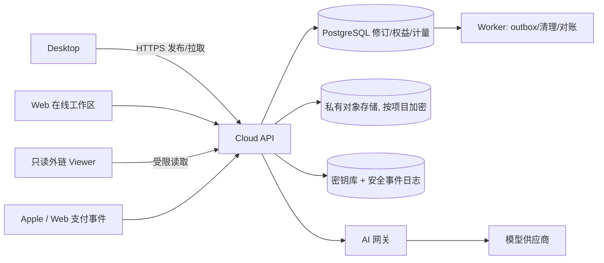

# Nodal Cloud 云服务技术设计

日期：2026-11-07  
状态：r2 初稿，配套 [云订阅与在线版方案](CLOUD_SUBSCRIPTION_AND_WEB_APP_PLAN.md)；P0 go/no-go 通过后进入实施。尚无实现或生产验收。  
代码基线：本地仓库 `95ccf42`。

## 0. 范围与设计原则

本文覆盖 P1（云工作区 Beta）与 P2（托管 AI 与付费上线）的实现设计，并在 §13 记录 Team 阶段的升级路径。

r1 按成熟多租户 SaaS 设计了授权代次参与 CAS、对象级三方合并、独立删除事实日志与意图冻结、多档套餐额度换算等机制。r2 的原则是：**首发只有个人工作区和只读分享，选用能覆盖同一风险的最小正确机制；Team 才需要的机制后置，但数据模型预留升级空间。**

| 风险（评审 ID） | r1 机制 | r2 首发机制 | 升级路径 |
| --- | --- | --- | --- |
| 删除/撤权在灾备恢复后复活（R03） | 独立事实日志 + 可信意图 + 冻结对账 | 按项目密钥粉碎 + 小型追加安全事件日志重放（§5） | 不变 |
| 并发与离线冲突（R10） | 操作日志、墓碑、安全水位、对象级三方合并 | 整包修订 + CAS，冲突时用户选择并生成恢复包（§4） | P4 对象级自动合并 |
| 在途撤权（R04） | 授权代次进入提交条件与多个检查点 | 授权检查移入提交事务；会话与分享按请求校验（§4.3） | P3 授权代次 |
| 额度多发或错扣（R08） | grant/reserve/settle 账本 + 升降级矩阵 | 单档套餐、周期计数行 + 幂等请求事件（§7） | 第二档或团队池时扩展为账本 |
| 供应商成本失控（R06） | 多维预算与熔断 | 三个硬上限 + 取消计次（§7.3） | 不变 |

## 1. 架构

沿用现有 Rust/Axum 云 API，保持模块化单体加一个后台 worker，不拆微服务。复用 React 的结构图、语义编辑、解释与导出组件，新增登录态的在线工作区平台实现，匿名只读 Viewer 的权限边界保持不变。

领域表（P1/P2）：`accounts`、`sessions`、`workspaces`、`projects`、`sources`、`snapshots`、`revisions`、`comments`、`shares`、`entitlements`、`payment_events`、`usage_periods`、`usage_events`、`jobs`、`outbox`。现有 `teams`/`team_members`/`projects` 显式迁移为 `workspaces` 模型，不平行建立第二套租户身份。

部署：静态 Web、API、worker、托管 PostgreSQL（含 PITR）、开启版本控制的私有对象存储、密钥管理服务。首期用 PostgreSQL outbox/jobs，测量达到阈值再引入独立队列。日志、监控、备份和生产权限在 P2 收费前具备。部署地域未选定前不声称数据驻留。

## 2. 身份与会话

- 现有运维 bootstrap 与公开注册分离，bootstrap secret 不下发给用户。
- 邮箱验证码登录：发送限流、防枚举、验证码一次性且短期有效、会话列表与远程登出。
- 网页使用 HttpOnly + SameSite Cookie 与 CSRF 防护；桌面通过系统浏览器 + PKCE 登录，刷新令牌存系统凭据存储，不存 URL 或 localStorage。
- 账号删除、支付管理等敏感操作需要重新验证。
- 引入第三方登录时另行核对 Apple 登录要求。

## 3. 数据契约与隐私

| 数据 | 处理 |
| --- | --- |
| 结构元数据、注释、业务域、逻辑关系、保存视图、布局 | 选定项目后进入发布白名单 |
| 数据库密码、连接 URI、SSH 密钥、API Key、SQLite 路径/书签、`source_profile` 中的主机与账号 | 留在本机；云项目只保存来源显示名与类型 |
| 查询结果、行数据、数据库文件 | 不进入云服务 |
| 查询历史、原始 SQL、源码片段 | 首期不同步；可能含业务值 |
| 自由文本注释、DDL 默认值 | 可能含敏感信息；发布前预览，可逐项排除 |
| AI 输入与输出 | 单独授权；不默认保存完整请求日志 |

- 发布协议使用版本化 schema 与**字段白名单**，在 API 端重新校验；现有敏感字段拒绝名单只作补充。非法字段、超大/过深 payload、跨租户引用、未知协议版本拒绝落库。
- 分享和 AI 各自生成更小的投影，不把完整内部 bundle 直接返回。
- 协议带最小支持版本；旧客户端不能覆盖其不认识的新字段。

## 4. 修订存储与同步

### 4.1 模型

- 一个工作区包含多个项目，一个项目包含多个来源（`sources`），避免沿用“一项目一 bundle”导致来源互相覆盖。
- **结构快照不可变**，按内容哈希存入对象存储，由 `snapshots` 记录来源、采集方式（桌面采集/DDL 导入/归档导入）与时间。在线编辑不能修改采集事实。
- **项目修订**是追加式的整包记录：每条 `revision` 引用各来源的当前快照 ID，加上该项目完整的语义层（注释、业务域、逻辑关系、视图、布局）。修订号在项目内单调递增，`projects.head_revision` 指向当前版本。
- 已有本地项目与云项目首次关联须显式确认，不按名称自动合并。

整包修订的取舍：每次提交都写完整语义层，存储有冗余，但元数据体积小，压缩后开销可接受（以 §14 容量基线验证）。好处是删除自然体现在下一条修订中，不需要墓碑、安全水位或操作重放协议。

### 4.2 提交

1. 客户端携带 `base_revision`、幂等键（租户范围唯一，绑定内容哈希）与协议版本提交。
2. 服务端在**同一事务**内：获取项目锁 → 校验会话、工作区成员身份与权益 → 校验 `base_revision == head_revision` → 写对象存储引用、插入修订、更新 head、写审计与 outbox。
3. 相同幂等键 + 相同内容哈希返回原结果；相同幂等键 + 不同内容拒绝。

现状缺陷：`apps/cloud-api/src/lib.rs` 的 `sync_bundle` 在获取事务锁之前调用 `require_project_role`。P1 首个改动即把授权检查移入锁后的事务内（§4.3）。

大对象先写临时 key 并校验大小与内容哈希，再在事务中提交引用；孤儿对象由 worker 异步清理，不删除已提交或仍在上传保护期的对象。

### 4.3 撤权与提交的一致性（首发）

首发只有个人工作区，需要撤销的是会话、分享和账号删除：

- 授权检查与 CAS 在同一事务、同一锁内完成，撤权事务与提交事务串行化，不存在“检查后、提交前被撤权”的窗口。
- 会话与分享在每个请求上校验当前状态，不缓存授权结果。
- Team 引入后再增加授权代次与长任务检查点（§13）。

### 4.4 拉取与冲突

- 客户端按 `head_revision` 轮询；SSE/WebSocket 后置，只作新修订通知。时钟只用于显示。
- CAS 冲突（HTTP 409）时，客户端拉取云端 head，先把本地未提交内容保存为**恢复包**，再按对象展示“本地 / 云端 / 共同基线”的差异（复用 `schema-diff` 与语义层比较）。首发提供三个选择：采用云端版本、用本地版本创建新修订（基于云端 head 重新提交）、另存为新项目。按对象逐项挑选作为时间允许时的增强。
- 共同基线已超出历史保留期时，仍可比较本地与云端两方，只是不显示基线列；旧操作永不自动重放。
- 失去访问权的设备提交会被事务内授权拒绝，不能回传或拉取。

### 4.5 DDL 导入与来源更新

- 浏览器端解析 DDL，生成新快照草稿；与该来源当前快照做 `schema-diff`，展示差异、覆盖缺口与重命名候选。
- 用户确认映射后提交新快照并创建新修订；未受影响的语义保留，受影响对象标记待复核。
- 未出现的对象标为“未知”，只有用户声明完整范围并确认后才作为删除提交。内容哈希与当前快照一致时只更新导入记录，不建新修订。

## 5. 历史、备份、删除与灾备

### 5.1 三个层级

| 层级 | 用途 | 机制 |
| --- | --- | --- |
| 同步当前状态 | 多设备继续工作 | `head_revision` + CAS |
| 用户版本历史 | 对比、追踪、撤销误改 | 追加式修订；恢复旧版生成新修订 |
| 服务灾备 | 平台故障后恢复 | PostgreSQL PITR、对象存储版本、恢复演练 |

内部目标草案：已确认提交的 RPO ≤ 15 分钟、RTO ≤ 4 小时，每日备份、35 天滚动保留，每月隔离环境恢复演练。实测达标前不对外承诺。

### 5.2 删除：按项目密钥粉碎

- 每个项目生成独立数据密钥（DEK）。修订中的语义层与对象存储中的快照都用 DEK 加密；DEK 由 KMS 主密钥包裹后存入**密钥库**。密钥库是与业务 PostgreSQL 分离的小型存储，有自己的备份。
- 彻底删除项目或账号时立即销毁对应 DEK：在线数据、对象存储历史版本以及 35 天内的业务库备份**同时变为不可读**，之后再由后台清理密文、索引和派生缓存。“彻底删除即不可读”可作为对外隐私说明，不必依赖备份过期。
- 回收站：用户删除先进入 30 天回收站（DEK 保留），到期或用户确认后销毁 DEK。

### 5.3 安全事件日志

业务库 PITR 回滚会丢失恢复点之后的撤销分享、登出和密钥销毁。因此在密钥库旁维护一个**只追加的安全事件日志**（对象锁/WORM 存储），只记录事件类型、主体 ID、对象 ID 和时间，不含项目正文：

- 记录的事件：DEK 销毁、分享撤销、会话撤销、账号删除。
- 顺序：先校验请求的身份与权限 → 写入日志 → 执行业务变更 → 告知用户完成。写日志失败则操作失败并提示重试；未通过校验的请求不进入日志。
- 回放幂等：重复应用同一事件不改变结果。

相比 r1 去掉了“可信意图 / 冻结 / 对账”状态机：因为日志项只在校验通过后写入，且每项都可独立幂等回放，恢复时全部回放即可。

### 5.4 灾备恢复步骤

1. 隔离流量，恢复 PostgreSQL 与对象存储到恢复点。
2. 回放恢复点之后的安全事件日志：销毁 DEK、撤销分享与会话。
3. 失效全部现有会话，强制重新登录。
4. 从外部事实源对账：支付状态从 Apple / Web 收款商重新拉取；AI 用量以供应商用量报告与 `usage_events` 对账。对账完成前暂停付费写入与托管 AI。
5. 校验对象引用完整性后开放读取。日志不可读时不开放恢复实例。

## 6. 分享、评论与下载

- 分享类型：指定邮箱（需登录免费账号）或只读外链（默认 7 天，可撤销/轮换，选择固定修订或跟随最新）。外链只返回分享投影，不暴露成员、审计或未分享历史。
- 所有项目内容、快照与归档下载经**鉴权代理**，不向用户签发对象存储预签名 GET URL；代理对每个请求（含 Range 请求）校验会话与分享当前状态，流式传输按块检查。私有内容不进入公共 CDN 缓存。已下载副本无法收回，分享与导出前在 UI 说明。
- 评论：锚定 `project_id + object_key + revision`，对象被重命名或删除时保留原锚点并标注。支持回复、标记处理、作者删除；按账号限制频率与数量；提供举报与封禁入口。评论不改变知识确认状态。

## 7. 托管 AI 与计量

### 7.1 Prepared request

沿用桌面 `table_understanding.rs` 中“预览与执行使用同一份服务端构建的请求体、内容签名校验”的做法：

- 预览阶段服务端按当前权限构建上下文，生成短期、单次的 prepared request，绑定账号、工作区、修订、对象集合、外发内容哈希、模型路由、策略版本和最高单位报价。
- 用户确认后只发送这份冻结内容。修订、策略或路由变化导致哈希不一致时要求重新预览。
- 模型输出按不可信内容处理；导入文档中的指令不当作系统指令；项目内容不跨租户检索。
- 供应商密钥只在服务端。

### 7.2 额度计量（单档套餐）

- `usage_periods`：每个计费主体每个服务周期一行，含 `allowance`、`used`、`reserved`，周期边界取自可信的权益记录（§8）。
- `usage_events`：每个 AI 请求一行，`request_id` 唯一，记录状态（reserved / settled / released）、预占与实际单位。
- 发送前在一个事务中锁定周期行，检查 `used + reserved + 本次最高单位 ≤ allowance`，插入 reserved 事件。完成后按实际单位结算；供应商失败或无可用结果时释放，不扣用户额度。
- 迟到结果仍归属原周期；预占超时由 worker 回收并对账，不盲目重试。
- 同一订阅期跨渠道重复订阅时，额度按覆盖期取最大值而非相加，并提示用户处理重复订阅（§8）。

### 7.3 平台成本硬上限

用户额度之外的独立保护，防止取消、失败与重试消耗平台成本：

1. 每用户每日尝试次数上限，**取消和失败同样计次**。
2. 每用户每日估算成本上限，请求发出即记账，取消不退回成本占用。
3. 全平台每日成本上限，触发熔断后暂停新调用并显示预计恢复时间。

管理面板展示成本、错误率、P95 延迟和单位成本。默认日志只保存计量字段与请求 ID，不保存提示词与结构；排障采样需短期授权并脱敏。

## 8. 订阅、渠道与权益

### 8.1 权益服务

- `entitlements`：`billing_subject`、`workspace_id`、产品、渠道（apple/web）、原始交易 ID（唯一）、`coverage_start/end`、状态、`generation`。
- 服务端授权顺序：身份 → 项目访问 → 云权益 → 额度。没有订阅不阻止合法取回；有订阅不代表能访问他人项目。
- 原始交易链唯一绑定一个计费主体，换 Nodal 账号不能自动抢绑，迁移需验证流程。

### 8.2 Apple

- 新增 StoreKit 2 自动续期订阅，通过 Swift 桥接接入 Tauri（现有只有 AppTransaction，可行性在 P0 spike 中验证）。购买时传入 `appAccountToken` 关联 Nodal 账号。
- 服务端验证交易签名、bundle/product/environment 与有效期；接收 App Store Server Notifications V2，并定期通过 App Store Server API 对账。Sandbox 与 Production 数据隔离。乱序或重复通知不回滚状态，漏通知由对账修正。
- 首发只有一个订阅产品，不存在组内升降级；需处理的事件为首购、续费、关闭自动续费、计费重试、宽限期、退款与撤销。

### 8.3 Web 收款

- 服务商待定（产品方案 D6）。webhook 幂等落入 `payment_events`，由同一权益服务生成 `entitlements`。
- Community/Windows 桌面端在系统浏览器打开网页结账，不在应用内处理卡信息。

### 8.4 状态与额度发放

| 状态 | 行为 |
| --- | --- |
| active | 开放服务，按周期创建 `usage_periods` |
| 已关闭续费未到期 | 保持当期服务，到期回落为免费账号 |
| 宽限期 | 仅按渠道确认的宽限有效期维持；不提前发放下一周期额度 |
| 计费重试且不在宽限期 | 停止新增付费资源，进入取回流程 |
| 到期/退款/撤销 | 停止付费服务；退款撤销对应周期的未用额度，已用量保留审计，不追收 |
| 验证暂时失败 | 显示核验中；云端不凭客户端自报放行，本地买断功能不受影响 |

跨渠道重复订阅：账号页面显示各渠道的有效期与管理入口，检测到重叠时提醒；权益覆盖期取并集，额度不叠加。Apple 订阅只能由用户在 Apple 侧取消，反之亦然。

## 9. 到期生命周期

- 到期状态按 `billing_subject + workspace_id + generation` 保存 `coverage_end`、`read_only_until`、`purge_after`。首发每个账号只有一个个人工作区，但按工作区建模，为 Team 预留。
- 清理任务执行前在工作区锁内重新核对覆盖期、权益代次与归档任务；续费或恢复订阅会递增代次，使旧清理任务失效。
- 已受理的归档任务最多获得超出原清理时间 72 小时的保护期，不能滚动延长；用户主动彻底删除优先于归档保护。

## 10. 可携带云归档

- 在现有 `PortableModelBackup`（`crates/snapshot-store`）基础上新增云归档格式版本：多个来源、保留期内的快照与修订、语义层、评论、当前 head 与映射表，附带格式版本、内容清单和逐项校验和。
- 不包含密码、会话、活跃分享令牌、支付记录、`source_profile` 中的主机与账号等字段。
- 网页端在有效期与取回窗口内生成，服务端校验完整性后才标记可下载，下载走 §6 的鉴权代理。
- **免费的 Community 桌面端即是离线读取与校验工具**：扩展现有 `import_portable_backup` 识别新格式，导入后重新映射身份，不恢复原账号权限、分享与计费绑定。另提供格式 JSON Schema 文档。

## 11. 桌面集成与 MAS

- `purchase.rs` 的 `unavailable_in_mas` 改为“能力 + 云权益”判断，新增云命令逐项放行；不能删除整个函数就视为完成。现有购买校验、恢复入口与 GitHub updater 隔离保持不变。
- 前端通过 `NodalStudioPlatform` 扩展云工作区接口，`tauri-platform.ts` 与 `web-platform.ts` 同时实现；不在组件内直接调用 `invoke()`。
- 发布前在桌面执行字段白名单检查与外发预览，服务端再次校验。

## 12. 迁移、灰度与回退

- 在隔离环境把现有 `project_bundles` 迁移为每来源的首条修订，保留原 payload 与映射并核对哈希；当前表没有的历史不补造。旧客户端写入经兼容层转换，无法表达的新字段拒绝覆盖并提示升级。
- 灰度顺序：内部账号 → 邀请 Beta → 少量付费 → 全量。发布写入、在线编辑、AI、收费入口分别有开关。出现一致性或计费异常时暂停写入/购买/调用，保留读取导出与本地使用，支付通知持续接收。已收款未交付的情况走人工退款流程。
- 数据库迁移只做向前兼容的增量步骤，不自动运行破坏性 down migration；P2 上线前完成一次停服、恢复、通知补发与用量对账演练。

## 13. Team 升级路径（P3）

以下机制在 r1 已设计，首发不实现，P3 立项时以本节为起点产出 Team 设计文档：

- **授权代次**：工作区/成员/项目 ACL 的代次进入 CAS 提交条件；长任务在启动、向供应商外发前、结果提交与读取时检查代次，撤权后取消未发出的请求并停止流式交付。
- **角色与权限矩阵**：Owner/Admin/Editor/Commenter/Viewer，项目 ACL、approve 权限、export 权限、作者不能自批。
- **席位与团队额度池**：席位按生效区间分配额度，成员日/月上限，防止反复换人重复领额；此时把 §7.2 计数行扩展为 grant → reserve → settle 账本。
- **组织认领**：最后一位 Owner 删除账号时撤销其访问、冻结所有权与计费变更，进入最长 30 天的认领流程，有效付费期内成员继续工作。
- **对象级自动合并**（P4）：如需不相交对象自动合并，再引入操作日志、墓碑与安全水位；届时须保证旧设备回连不复活已删除对象。

## 14. 验收场景

| # | 场景 | 阶段 |
| --- | --- | --- |
| 1 | 老买断用户离线、未注册、订阅到期及云故障时本地功能照常 | P1 |
| 2 | 两端修改同一项目、断网重连、提交成功但响应丢失：不丢修改，恢复包可用，同一幂等键不同内容被拒 | P1 |
| 3 | 撤销分享/登出与提交并发：撤销后的提交被拒；新请求与 Range 请求被拒；流式下载在下一块停止 | P1 |
| 4 | 删除项目后从删除前的恢复点恢复：内容不可解密，分享不复活，会话全部失效 | P1 |
| 5 | 离线超过历史保留期的设备回连：不自动重放，可比较两方并选择 | P1 |
| 6 | 第二次导入 DDL 更新同一来源：保留注释；部分解析不误删；重复文件不建修订 | P1 |
| 7 | 无订阅用户下载归档，在 Community 桌面打开、校验并重新导入 | P1 |
| 8 | 合成 1,000 表、20,000 字段模型：记录修订大小、P95、峰值内存与存储成本 | P1 |
| 9 | 跨租户访问、伪造工作区 ID、超大/过深 payload、未知协议版本均被拒 | P1 |
| 10 | AI 并发、取消、超时、供应商失败、重试、迟到结果：计量一致，不重复结算 | P2 |
| 11 | 预览后修改项目或策略：原确认不能发送新内容 | P2 |
| 12 | 不同 request ID 反复取消/超时不能突破成本硬上限 | P2 |
| 13 | 真实 Apple 交易：首购、续费、宽限、退款、撤销、乱序与重复通知、恢复购买 | P2 |
| 14 | 网页与 Apple 重复订阅：提醒、覆盖期并集、额度不叠加 | P2 |
| 15 | 签名 MAS 包端到端：登录、购买、发布、导出、注销；不以前端模拟代替 | P2 |
| 16 | 灾备恢复后支付与 AI 用量对账完成前，付费写入与 AI 保持暂停 | P2 |
